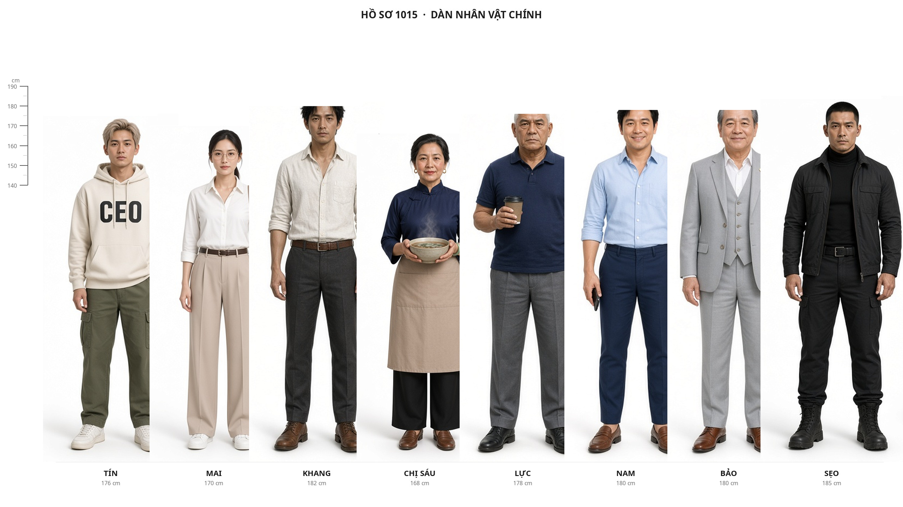

# HỒ SƠ 1015 – Kịch bản phim điện ảnh

Phim hành động – điều tra hình sự, pha hài. Thời lượng dự kiến 115 phút.

> *Người chết để lại bốn con số. Người sống phải tìm ra chúng có nghĩa gì – trước khi bị bịt miệng.*

Một cựu cảnh sát hình sự bị đuổi khỏi ngành, một cậu trợ lý "nổ" như pháo, và em gái của một nữ nhà báo vừa chết, lần theo bốn con số **1015** để lật tẩy đường dây thuốc giả núp bóng quỹ từ thiện – và kẻ phản bội đã khiến đồng đội anh chết hai năm trước.

## Bản đọc trọn bộ (khuyên dùng)

Toàn bộ kịch bản gộp thành một tài liệu duy nhất (bìa, mục lục, 6 phần, ~95 trang A4) trong thư mục `xuat-ban/`:

| File | Mở bằng |
|---|---|
| [`xuat-ban/Ho-So-1015-Kich-Ban-Phim.pdf`](xuat-ban/Ho-So-1015-Kich-Ban-Phim.pdf) | Bất kỳ trình đọc PDF, điện thoại, trình duyệt |
| [`xuat-ban/Ho-So-1015-Kich-Ban-Phim.docx`](xuat-ban/Ho-So-1015-Kich-Ban-Phim.docx) | Microsoft Word, Google Docs, LibreOffice |
| [`xuat-ban/Ho-So-1015-Kich-Ban-Phim.html`](xuat-ban/Ho-So-1015-Kich-Ban-Phim.html) | Trình duyệt web |
| [`xuat-ban/Ho-So-1015-Kich-Ban-Phim.txt`](xuat-ban/Ho-So-1015-Kich-Ban-Phim.txt) | Notepad hoặc bất kỳ trình soạn thảo nào |

## Character sheet (tạo hình nhân vật)

Thiết kế tạo hình 8 nhân vật chính theo phong cách Sài Gòn 2026: hiện đại, cao ráo, trang phục tailored, da hồng hào trang điểm nhẹ. Mỗi sheet gồm toàn thân (trước / 3-4 / sau), cận mặt hai biểu cảm và bảng màu.

| File | Nội dung |
|---|---|
| [`xuat-ban/Ho-So-1015-Character-Sheet.pdf`](xuat-ban/Ho-So-1015-Character-Sheet.pdf) | **Bản PDF trọn bộ** – lineup + 8 sheet + bảng thông số (tuổi, chiều cao, da, trang điểm, trang phục, bảng màu) |
| [`character-sheet/character-lineup.jpg`](character-sheet/character-lineup.jpg) | Lineup so sánh chiều cao toàn dàn nhân vật |
| [`character-sheet/character-sheet-*.jpg`](character-sheet/) | Sheet riêng từng nhân vật: Khang, Tín, Mai, Chị Sáu, Lực, Nam, Bảo, Sẹo |
| [`character-sheet/character-sheet.md`](character-sheet/character-sheet.md) | Bản nguồn mô tả thông số và ghi chú hoá trang |

## Mục lục bản nguồn (Markdown)

| File | Nội dung |
|---|---|
| [`kich-ban/01-tong-quan.md`](kich-ban/01-tong-quan.md) | Logline, tóm tắt, chủ đề, tông phim, ý nghĩa con số 1015 |
| [`kich-ban/02-nhan-vat.md`](kich-ban/02-nhan-vat.md) | Hồ sơ nhân vật chính, phụ, phản diện và sơ đồ quan hệ |
| [`kich-ban/07-toan-bo-nhan-vat.md`](kich-ban/07-toan-bo-nhan-vat.md) | **Toàn bộ 32 vai có tên** + khoá mặt Khang ≠ Nam ≠ Bảo ≠ Lực |
| [`boi-canh/boi-canh-anh-sang.md`](boi-canh/boi-canh-anh-sang.md) | 12 plate bối cảnh, ánh sáng ba lớp, gộp lịch quay |
| [`kich-ban/03-cau-truc.md`](kich-ban/03-cau-truc.md) | Beat sheet ba hồi, đường dây hài của Tín, đường dây "1015" |
| [`kich-ban/04-kich-ban-hoi-1.md`](kich-ban/04-kich-ban-hoi-1.md) | **Hồi 1** – Cái chết và bốn con số (cảnh 1–22) |
| [`kich-ban/05-kich-ban-hoi-2.md`](kich-ban/05-kich-ban-hoi-2.md) | **Hồi 2** – Mở rộng, sụp đổ và sự thật (cảnh 23–50) |
| [`kich-ban/06-kich-ban-hoi-3.md`](kich-ban/06-kich-ban-hoi-3.md) | **Hồi 3** – Dưới ánh đèn (cảnh 51–64) |

## Nhân vật chính

- **Lê Minh Khang** – thám tử tư, cựu trinh sát hình sự. Không nhận tiền bẩn, nên nghèo.
- **Tín Nổ** – trợ lý, tự xưng hacker, thực chất cựu nhân viên call center lừa đảo đã hoàn lương. Nguồn hài chính của phim – nhưng mỗi lần "nổ" đều có hậu quả thật.
- **Vũ Thanh Mai** – dược sĩ, em gái nạn nhân. Kiến thức dược là vũ khí của cô.
- **Chị Sáu** – chủ quán phở, chủ nhà, tính tiền nhà bằng phở.
- **Thượng tá Lực** – người Khang thù ghét, hoá ra là đồng minh.
- **Đại uý Nam** – người bạn duy nhất của Khang, hoá ra là kẻ phản bội.
- **Trịnh Quốc Bảo** – chủ tịch tập đoàn dược, nhà từ thiện, kẻ chủ mưu. *"Tôi thích làm việc dưới ánh đèn."*

## Bốn set piece hành động

1. Cầu thang bộ chung cư – bình chữa cháy và ống rác
2. Rừng đước Cần Giờ – đuổi bắt bằng ghe máy
3. Hẻm Quận 4 – xe máy, xe bánh mì và đường ray xe lửa
4. Bếp khách sạn năm sao – chảo gang, vòi xịt và băng chuyền rửa chén
