# HỒ SƠ 1015 — BỐI CẢNH & ÁNH SÁNG CHIỀU SÂU

Mọi set phải **đọc được thành ba lớp**: gần / giữa / xa. Nếu chỉ còn một lớp phẳng, set đó chưa quay.

Ánh sáng luôn có nguồn trong khung (đèn huỳnh quang, nồi phở, LED gala, cửa sổ). Không sky mềm đều. Không studio trắng trừ character sheet.

---

## Luật ánh sáng (áp mọi set)

1. **Ba lớp không gian.** Một vật gần camera (mờ), một hành động giữa, một thế giới phía sau đang phai.
2. **Haze / hơi / khói là nhân vật.** Bụi hầm xe, hơi phở, sương đước, hơi bếp, sương nghĩa trang — để ánh sáng có thể tích, không chỉ có bề mặt.
3. **Ấm đấu lạnh.** Một nguồn ấm (tungsten, lửa, đèn quán) cắt một nguồn lạnh (huỳnh quang, bình minh, LED). Đó là chiều sâu bằng màu.
4. **Đường tụ.** Hàng xe máy, hẻm, dãy tủ, lạch đước, băng chuyền chén — một điểm biến mất. Điện thoại 9:16 vẫn giữ đường này, chỉ crop dọc.
5. **Không master phẳng.** Cần Sài Gòn thì để làm nền sau một lan can hoặc một cửa sổ, không để làm postcard.
6. **Chữ trên hình là đồ thật.** Biển phở bạc màu, số tủ, timestamp camera. Không title đẹp đè lên plate.

---

## Bản đồ set theo cung

| Cung | Set chính | Nhiệt màu |
|---|---|---|
| 1. Bốn con số | Hầm xe, sân thượng Skyline, hẻm phở, văn phòng, căn 1508 / 1015 | Lạnh đêm → ấm quán |
| 2. Cuốn sổ | Phà, rừng đước, An Sinh, cháy, ga, hẻm đuổi | Xám sông → xanh đước → vàng lửa |
| 3. Dưới ánh đèn | Ballroom, bếp, sân thượng khách sạn, nghĩa trang, biển mới | Vàng gala → thép bếp → sương sáng |

---

## 1. Hầm xe Skyline — đêm

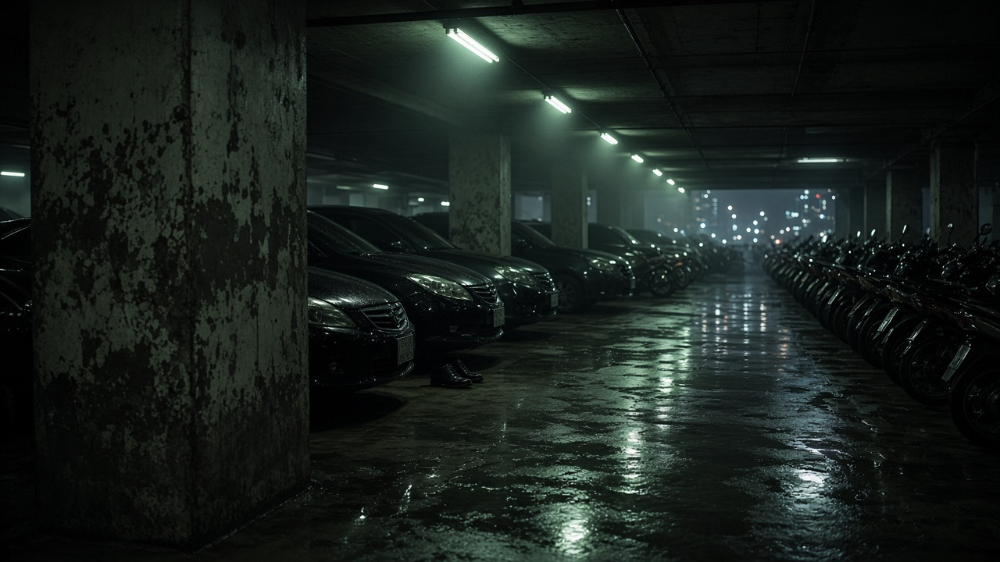

- **Lớp:** cột gần / hàng xe giữa / đèn cuối dãy.
- **Sáng:** huỳnh quang xanh-trắng chớp, vũng nước phản chiếu. Một đôi giày da giữa khung.
- **Việc:** Tập 01. Voicemail. 1015 lên tay.
- **9:16:** crop dọc một làn xe. Giữ điểm tụ.

## 2. Sân thượng Skyline — đêm

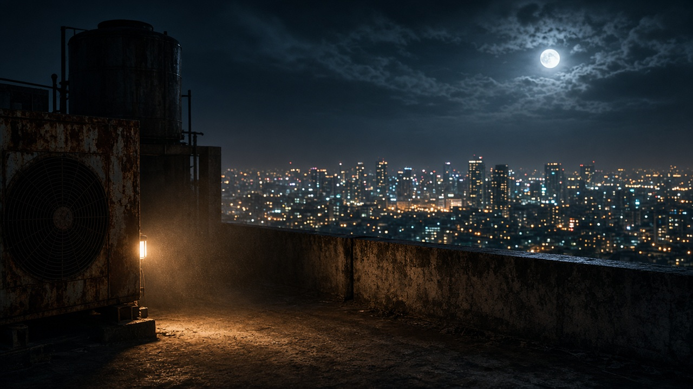

- **Lớp:** cục nóng / lan can / thành phố bokeh dưới chân.
- **Sáng:** trăng cứng + sodium. Gió thổi bụi thành volume.
- **Việc:** Tập 03–04. Sẹo. Rơi. Mirror với sân thượng khách sạn.
- **Khoá:** cùng độ cao, cùng thành phố — Tập 53 chồng lên đây một khung.

## 3. Hẻm Phở Sáu — bình minh / đêm

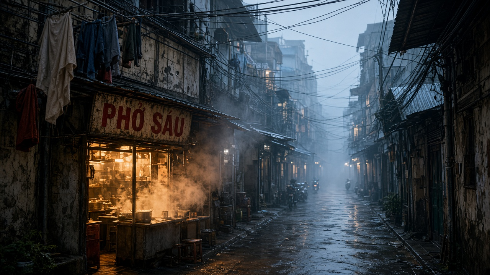

- **Lớp:** dây phơi / quán 3 mét / đáy hẻm.
- **Sáng:** hơi nước lèo ấm xuyên sáng xanh sáng sớm. Biển bạc màu.
- **Việc:** Tập 05, 30 (cháy), 58 (biển mới). Nhà của phim.
- **Xe tải chị Sáu** đỗ ở miệng hẻm — foreground đêm gala.

## 4. Văn phòng thám tử — gác 25 m²

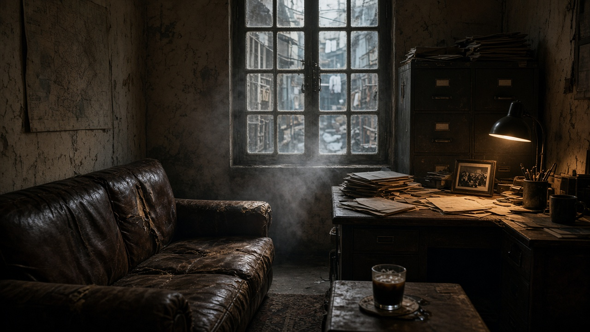

- **Lớp:** sofa rách / bàn + ảnh Dũng / cửa sổ hơi phở.
- **Sáng:** đèn bàn ấm vs cửa sổ lạnh. Bụi trong luồng sáng.
- **Việc:** Tập 05–07, 24–25, 60. Nơi Khang từ chối rồi nhận. Nơi Tín nấu mì. Nơi gõ cửa cuối.
- **Sau cháy:** cùng góc, tường ám khói, mèo trên hồ sơ.

## 5. Phà Bình Khánh — bình minh

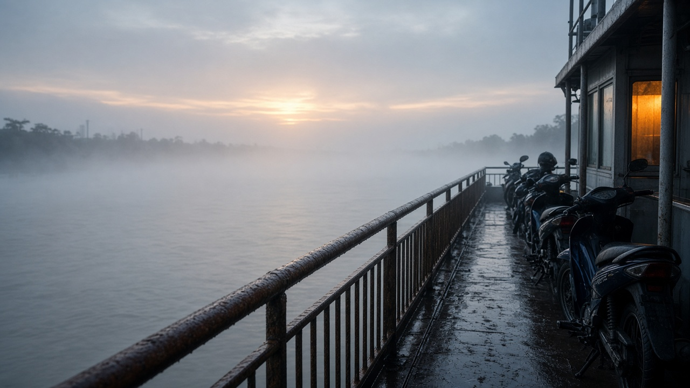

- **Lớp:** lan can ướt / hàng xe / bờ xa trong sương.
- **Sáng:** bạc-xám, một đèn cabin ấm. Sông Soài Rạp không xanh postcard.
- **Việc:** Tập 18. Tín nổ Lisbon. Mũ fullface 59-X1.

## 6. Rừng đước / chòi ông Tư — ngày

- **Lớp:** rễ ướt / chòi lá / đường hầm đước.
- **Sáng:** god-ray qua tán, hơi ẩm, nước soi lớp hai.
- **Việc:** Tập 19–23. Súng tự chế. Sổ. Sẹo. Ông Tư chết.
- **Không** quay đước thành cảnh du lịch. Luôn có bóng trong rễ.

## 7. Trụ sở An Sinh — ngày

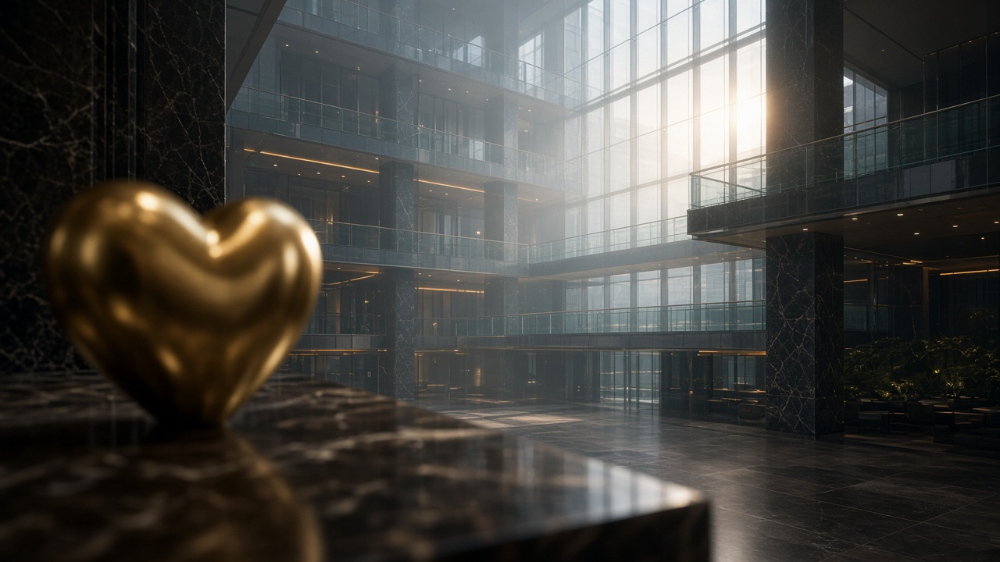

- **Lớp:** đá hoa + khối trái tim / atrium tầng / kính trời.
- **Sáng:** daylight lạnh, accent vàng. Bụi trong sảnh cao.
- **Việc:** Tập 27–28. Tín thầy phong thuỷ. Bảo tin sái cổ.
- **Tầng 18:** cùng lạnh, một bình hoa giấu máy.

## 8. Ga Sài Gòn — tủ gửi đồ — sáng sớm

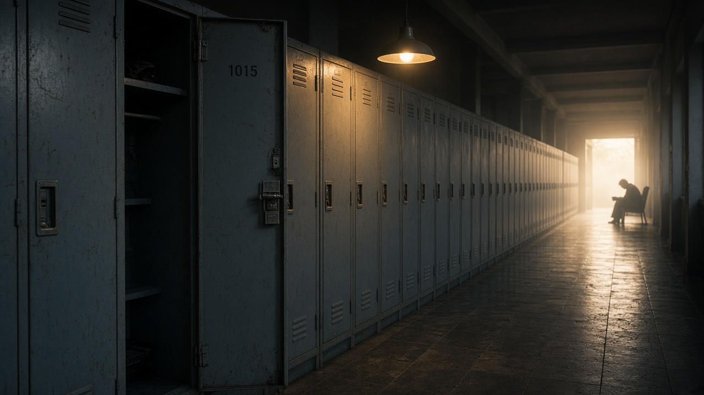

- **Lớp:** cửa tủ gần / dãy sắt / cửa sáng cuối hành lang.
- **Sáng:** thép lạnh + đèn treo ấm. Số **1015**.
- **Việc:** Tập 36–37, 40. Lớp nghĩa thật. Chúng đã biết tủ.

## 9. Ballroom khách sạn Đế Vương — đêm

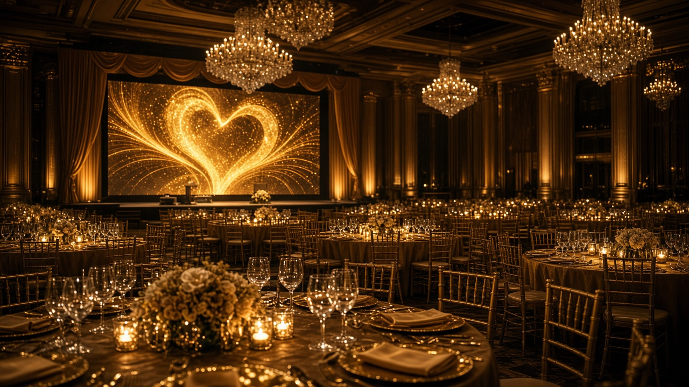

- **Lớp:** bàn vàng gần / ghế / LED + chùm đèn.
- **Sáng:** chandelier bokeh, LED vàng. Đẹp đến mức giả.
- **Việc:** Tập 45, 50–52. Tín cướp mic. 200.000 live.
- **Đối lập bắt buộc:** LED phải chứa được chòi lá ông Tư — cùng khung, hai thế giới.

## 10. Bếp trung tâm — đêm

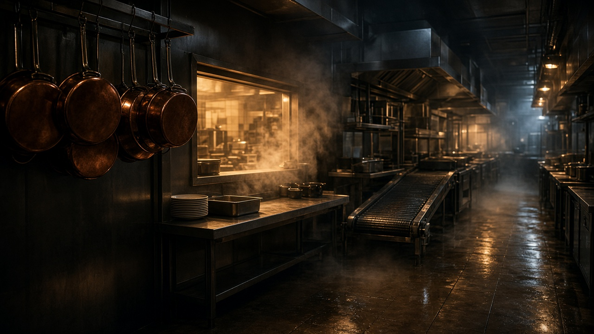

- **Lớp:** chảo treo / cửa pass / băng chuyền mất hút.
- **Sáng:** hơi nước, thép phản quang, tungsten nóng.
- **Việc:** Tập 48–49. Khang vs Sẹo. Không súng — có camera hành lang.

## 11. Sân thượng khách sạn — đêm

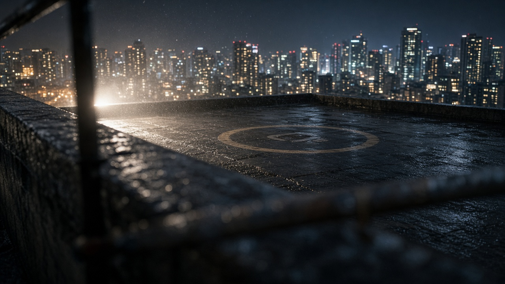

- **Lớp:** lan can gần (mờ) / sàn ướt / thành phố rơi xuống.
- **Sáng:** backlight cứng, gió máy bay. Cùng logic Skyline.
- **Việc:** Tập 53–55. Mai, Nam, Bảo ở mép. “Mày sẽ sống. Để ra toà.”

## 12. Nghĩa trang — sáng

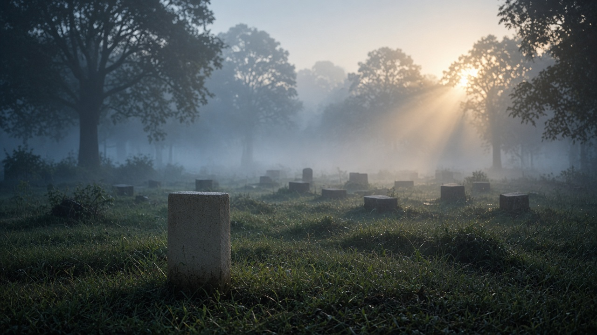

- **Lớp:** một nấm không hoa / đá xa / cây trong sương.
- **Sáng:** xanh sáng vs viền nắng. Im.
- **Việc:** Tập 57. Mai treo chìa rồi lấy lại.

---

## Trang đủ set

Hết 33 plate — không còn set phụ chưa ảnh: [`trang-boi-canh.md`](trang-boi-canh.md).

Cầu thang · sảnh · 1508 · phòng rác · quán phở nội · toà soạn · 1015 · café Nguyễn Du · xóm chài · kho Bình Chánh · tầng 18 · viện · khoa nhi · phòng công an · Tao Đàn · khách sạn mini · hẻm đuổi · thảm đỏ · booth · VIP 20 · cổng sau.

---

## Quay tuần — gộp theo ánh sáng, không theo số tập

| Đêm / ngày | Gộp | Xem trang |
|---|---|---|
| Một đêm Skyline | hầm + thang + sân thượng + sảnh | trang-boi-canh 1–4 |
| Một ngày hẻm + căn | phở + văn phòng + 1508 + 1015 + toà soạn | 5–12 |
| Một bình minh sông | phà + xóm chài + đước + kho flash | 13–16 |
| Một ngày kính | An Sinh + tầng 18 + lab + khoa nhi | 17–20 |
| Một chiều ga | tủ + mini + hẻm đuổi + Tao Đàn + công an | 21–25 |
| Một đêm Đế Vương | thảm đỏ + ballroom + booth + VIP + bếp + sân + cổng | 26–32 |
| Một sáng im | nghĩa trang + văn phòng mới | 33, 9 |

Tín’s phone đã là 9:16. Footage đó không cần relight — chỉ cần hạt và hơi của set đang đứng.

---

## Drive

- 10 Toàn bộ nhân vật: https://docs.google.com/document/d/1II0tNBiyRqCIYrtOTVszQc-xZrdo_NkO5cz0TCW6SUg/edit
- 11 Bối cảnh + ánh sáng: https://docs.google.com/document/d/1aB4_M_YDRHnUN7CKOrFlDomonTQymbsNNLGbcVhxAbo/edit
- 13 Trang bối cảnh (đủ 33 plate): tạo cùng thư mục Drive Hồ Sơ 1015
