# TRANG BỐI CẢNH — HỒ SƠ 1015

Mọi set có heading trong kịch bản. Tám chính và dàn phụ nằm ở character-sheet. Trang này giữ hết bối cảnh.

Luật một dòng: **ba lớp** (gần / giữa / xa) · **haze** · **ấm đấu lạnh** · **đường tụ** · nguồn sáng trong khung. Không sky đều. Không studio trắng.

| Cung | Số plate | Nhiệt màu |
|---|---|---|
| 1. Bốn con số | 12 | Lạnh đêm → ấm quán |
| 2. Cuốn sổ | 12 | Xám sông → xanh đước → vàng lửa |
| 3. Dưới ánh đèn | 9 | Vàng gala → thép bếp → sương sáng |

33 plate. Không còn “set phụ chưa plate”.

---

## Cung 1 — Bốn con số

### 1. Hầm xe Skyline — đêm
Tập 01. Voicemail. 1015 lên tay.

Cột gần / hàng xe giữa / đèn cuối dãy. Huỳnh quang xanh-trắng, vũng nước.

### 2. Cầu thang bộ Skyline — đêm / ngày
Tập 02, 13. Set piece bình chữa cháy.
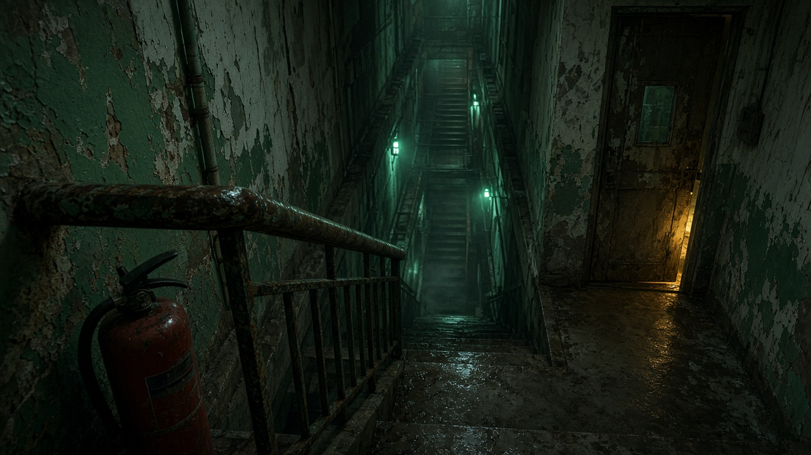
Tay vịn + bình / chiếu nghỉ / giếng thang. Đèn khẩn cấp xanh, cửa ấm.

### 3. Sân thượng Skyline — đêm
Tập 03–04. Sẹo. Rơi. Mirror tập 53.

Cục nóng / lan can / thành phố bokeh.

### 4. Sảnh Skyline — ngày
Tập 10. Quân. Tín giả nhân viên dọn nhà.
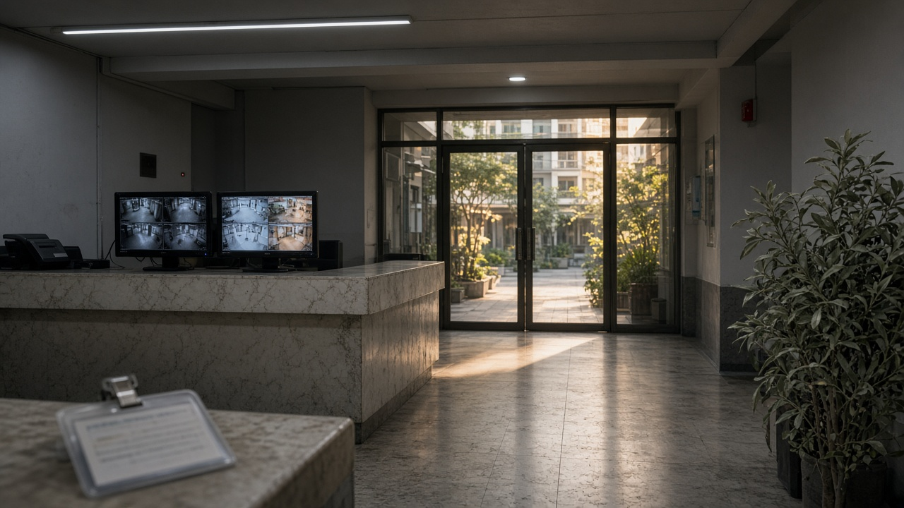
Thẻ khách / quầy / cửa kính sân trong.

### 5. Căn 1508 của Hà — ngày
Tập 11–12. Đã bị lục. Vỉ thuốc còn nguyên.
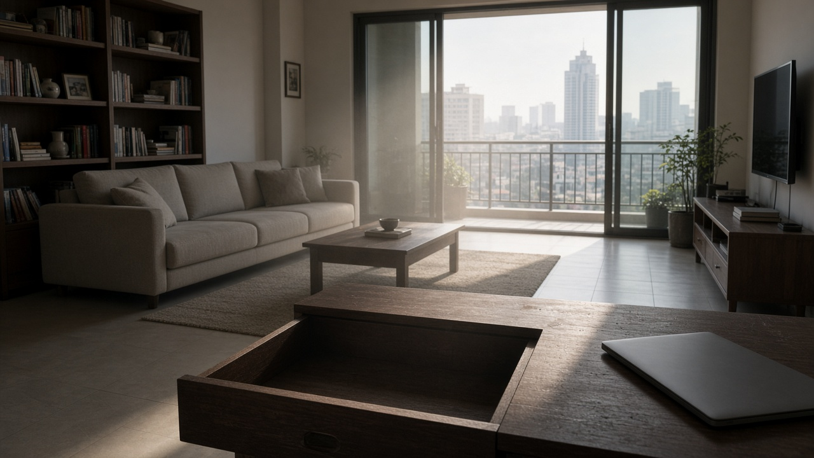
Ngăn kéo trống / phòng / cửa sổ. Ban ngày phẳng *cố ý*.

### 6. Phòng chứa rác / ống rác — ngày
Tập 15–17. Thoát.
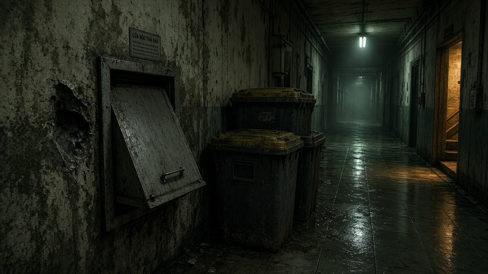
Cửa ống / thùng / hành lang kỹ thuật.

### 7. Hẻm Phở Sáu — bình minh / đêm
Tập 05, 30, 58. Nhà của phim.

Dây phơi / quán 3 mét / đáy hẻm. Hơi lèo ấm.

### 8. Quán Phở Sáu — nội, đêm đóng cửa
Tập 18, 63. Ghế úp. Mèo ăn tái.
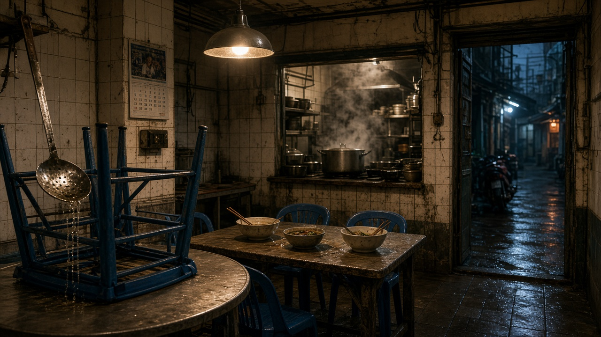
Ghế chồng / một bàn hạ / bếp còn hơi.

### 9. Văn phòng thám tử — gác 25 m²
Tập 05–07, 24–25, 60.

Sofa rách / bàn + ảnh Dũng / cửa sổ hơi phở.

### 10. Toà soạn Báo Sài Gòn Mới — sáng
Tập 9A. Linh đưa nháp.
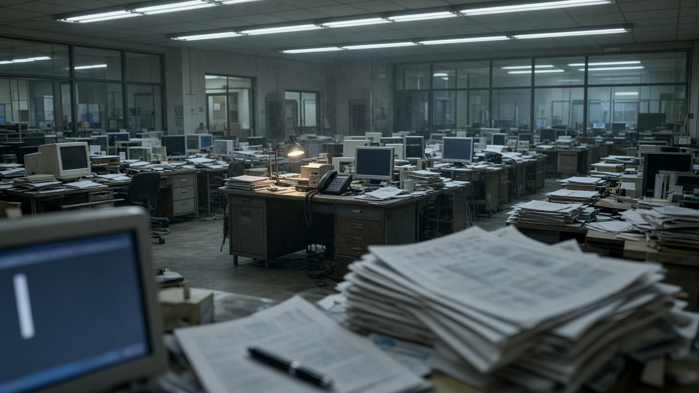
Con trỏ / hàng bàn / cabin kính. Huỳnh quang mệt.

### 11. Căn 1015 bà Lan — ngày
Tập 21. Lớp nghĩa đầu.
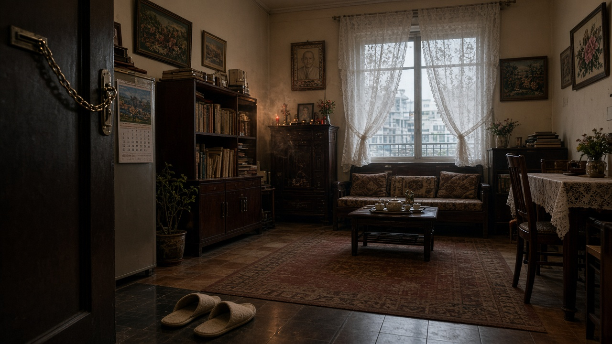
Xích cửa + dép / phòng khách / lịch tủ lạnh. Ren chiều.

### 12. Quán cà phê Nguyễn Du / vỉa hè CSHS — sáng
Tập 19 (Nam), 30 (Lực).
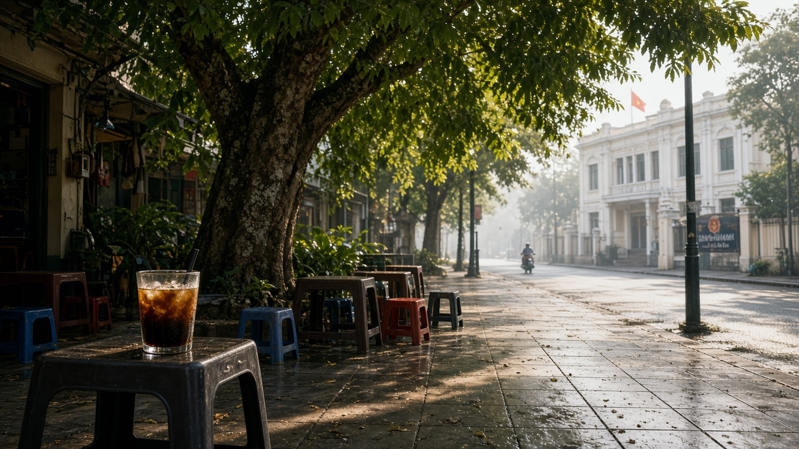
Ly đen / bàn nhựa / phố. Nắng vỉa hè.

---

## Cung 2 — Cuốn sổ

### 13. Phà Bình Khánh — bình minh
Tập 18. Tín nổ Lisbon.

Lan can ướt / hàng xe / bờ xa.

### 14. Xóm chài Thạnh An — ngày
Tập 24. Ông Tư chĩa súng. Tín làm con tin 30 giây.
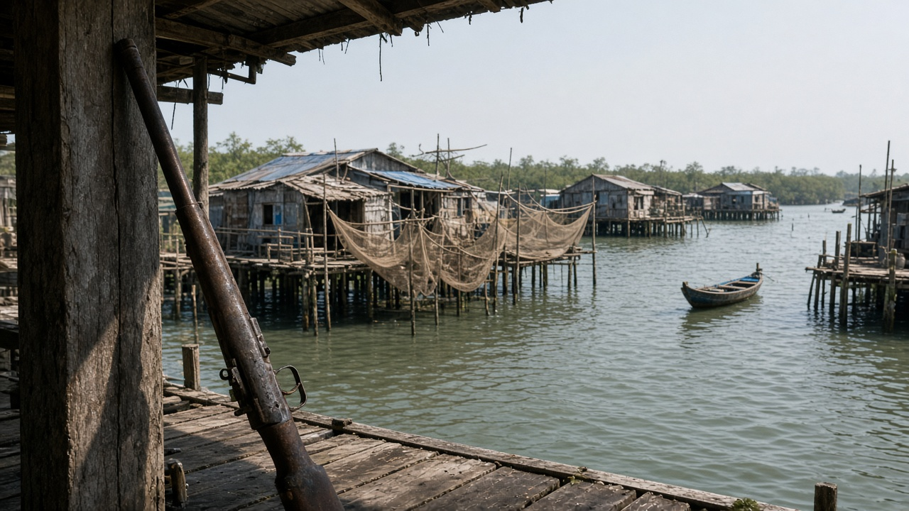
Súng tự chế / nhà sàn / nước đước.

### 15. Rừng đước / chòi ông Tư — ngày
Tập 19–23. Sổ. Ông Tư chết.

Rễ ướt / chòi lá / đường hầm god-ray.

### 16. Kho Bình Chánh — đêm, flashback
Tập 08. Dũng chết.
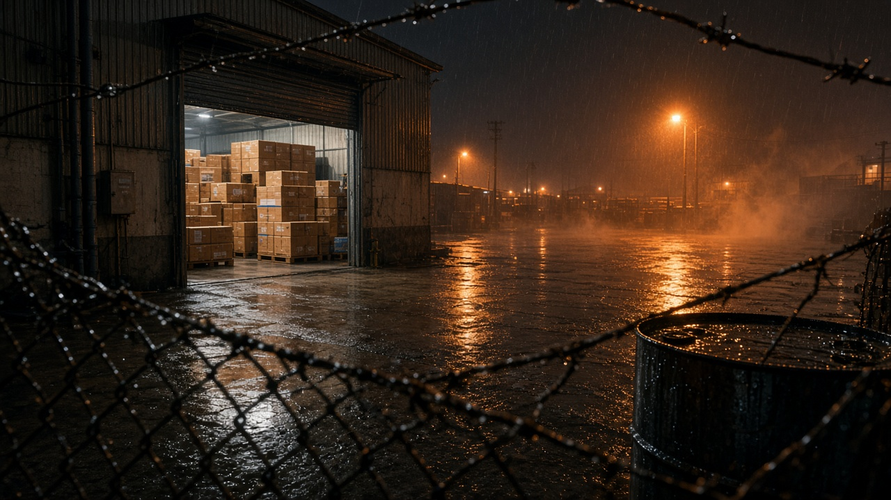
Hàng rào mưa / cửa kho / sodium ướt.

### 17. Trụ sở An Sinh — ngày
Tập 27–28. Tín thầy phong thuỷ.

Đá hoa + khối tim / atrium / kính trời.

### 18. Tầng 18 — phòng Chủ tịch — ngày
Tập 32–33. Cá rồng. “Bạn nó lo rồi.”
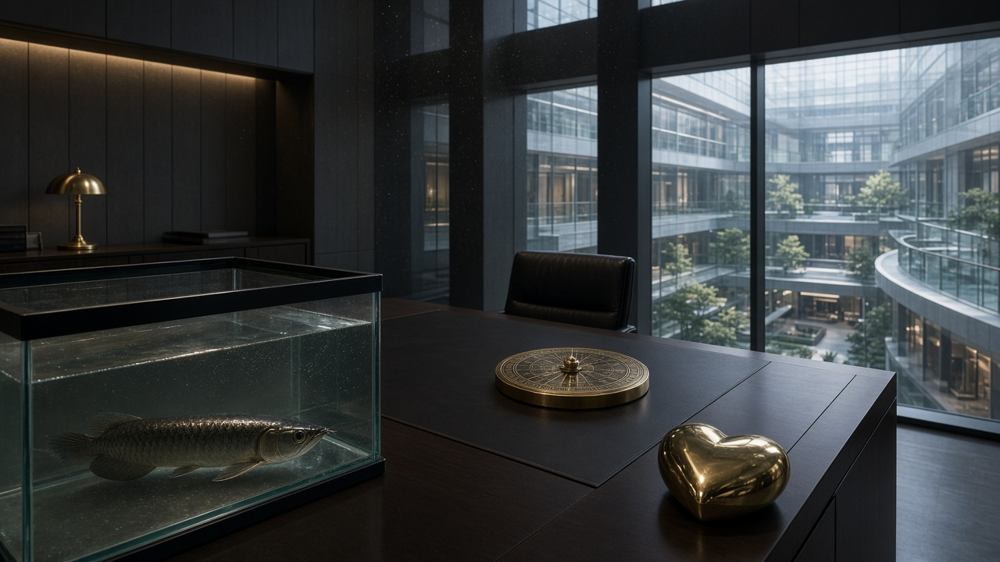
Bể cá + ghim vàng / bàn trống / atrium phía dưới.

### 19. Viện Kiểm nghiệm — ngày
Tập 40. Hạnh ký 8,3%.
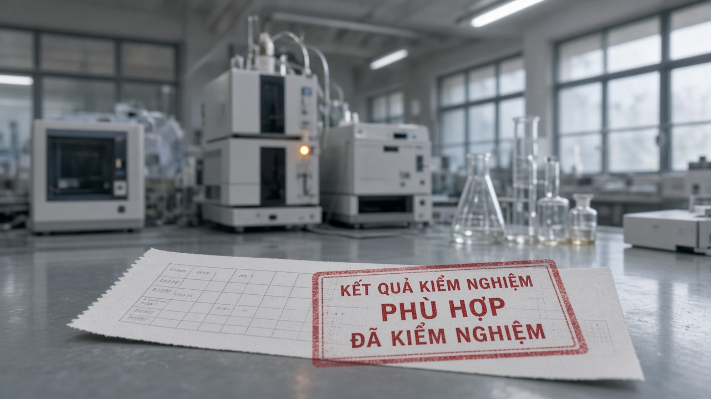
Dải giấy + dấu đỏ / máy / kính.

### 20. Hành lang khoa nhi — ngày
Tập 40A. Hương + bé Minh.
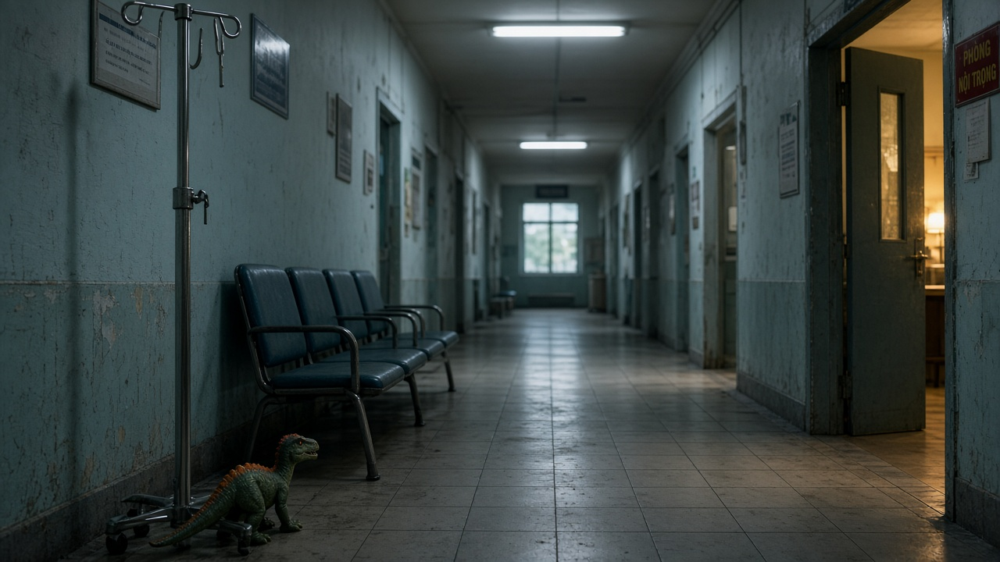
Cây dịch + đồ chơi / ghế / cuối hành lang.

### 21. Phòng công an — đêm
Tập 39. Lực thả. 48 giờ.
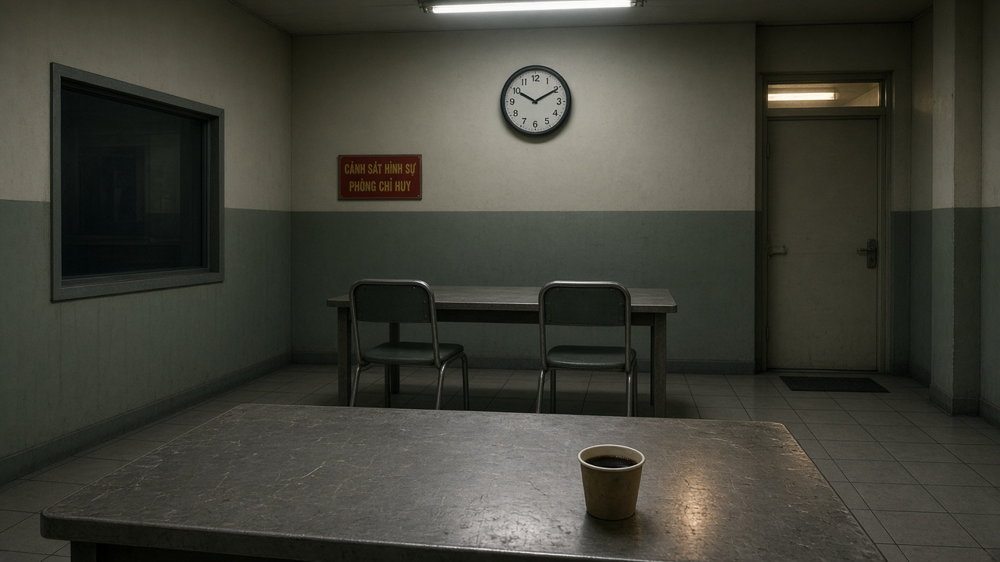
Ly đen / hai ghế / cửa kính một chiều.

### 22. Công viên Tao Đàn — chiều
Tập 35. Khang giao sổ cho Nam.
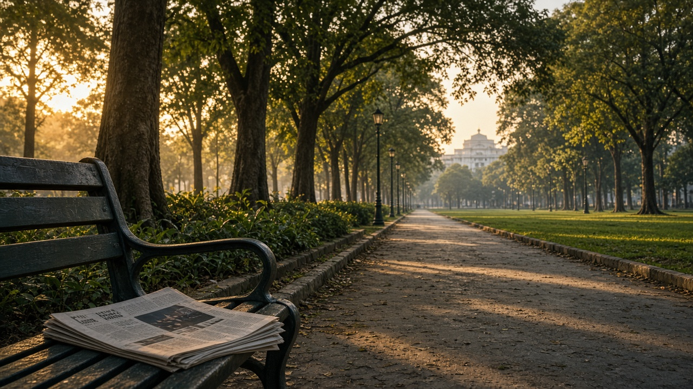
Ghế đá / đường cây / toà nhà phai.

### 23. Khách sạn mini Quận 4 — đêm
Tập 41, 43, 48–50. Ẩn. USB. Tối hậu thư.
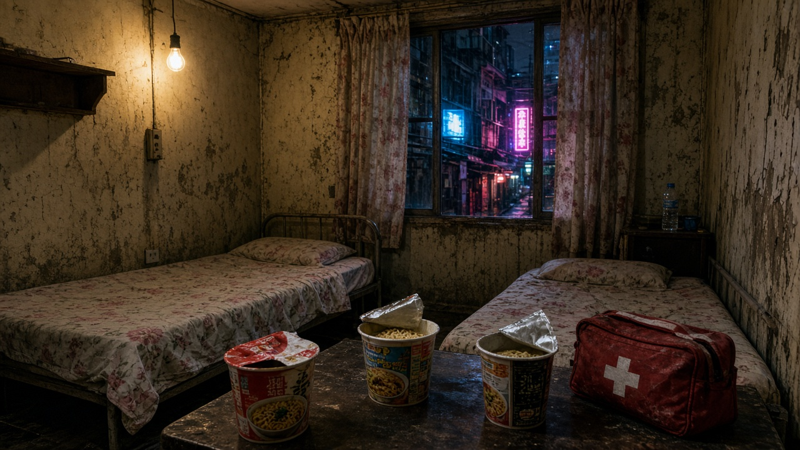
Mì gói + bông băng / hai giường / neon hẻm.

### 24. Ga Sài Gòn — tủ gửi đồ — sáng
Tập 36–37, 40. Lớp nghĩa thật.

Cửa tủ gần / dãy sắt / cửa sáng. Số 1015.

### 25. Hẻm đuổi / đường ray — chiều
Tập 45–47. Mai bị bắt. Tín đâm xe bánh mì.
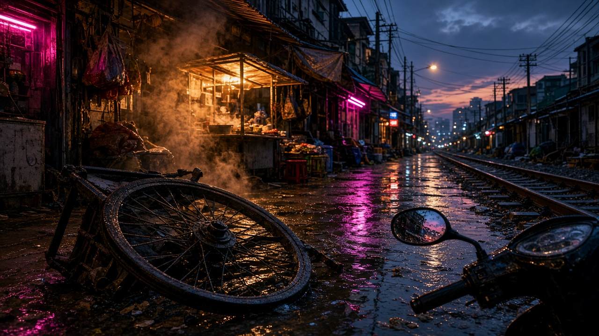
Bánh xe + gương / chợ neon / ray mất hút.

---

## Cung 3 — Dưới ánh đèn

### 26. Thảm đỏ Đế Vương — đêm
Tập 51–53. Tín vào vai KOL.
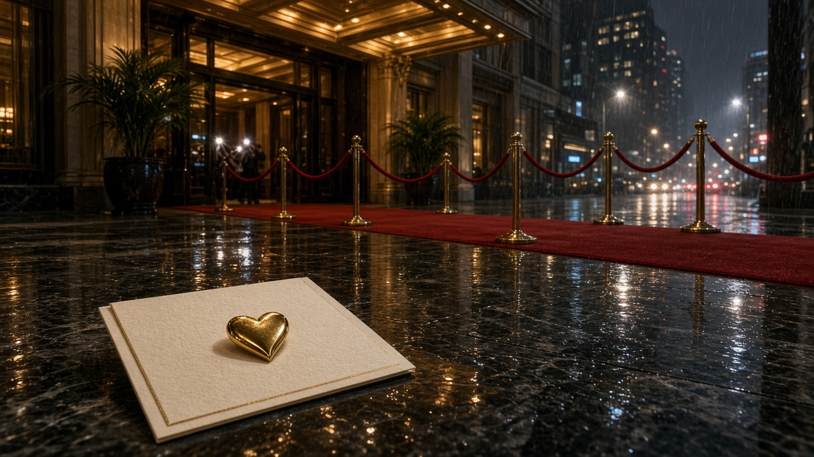
Thiệp + ghim tim / thảm / mái hiên mưa.

### 27. Ballroom Đế Vương — đêm
Tập 45, 50–52. 200.000 live.

Bàn vàng / ghế / LED + chùm đèn.

### 28. Booth kỹ thuật — đêm
Tập 55. Khoa. SURPRISE.
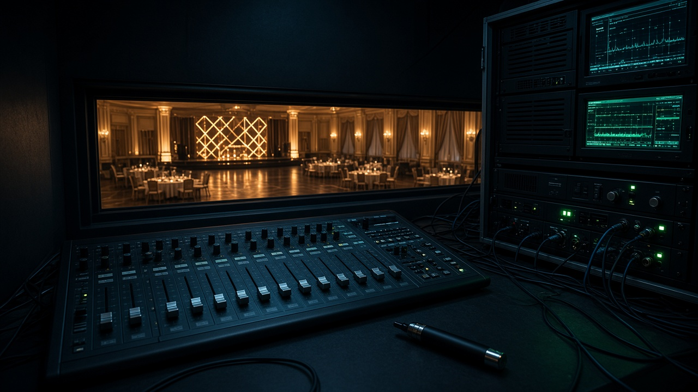
Fader / rack xanh / khe nhìn sân khấu.

### 29. Phòng VIP tầng 20 — đêm
Tập 56. USB giả. Máy meo meo.
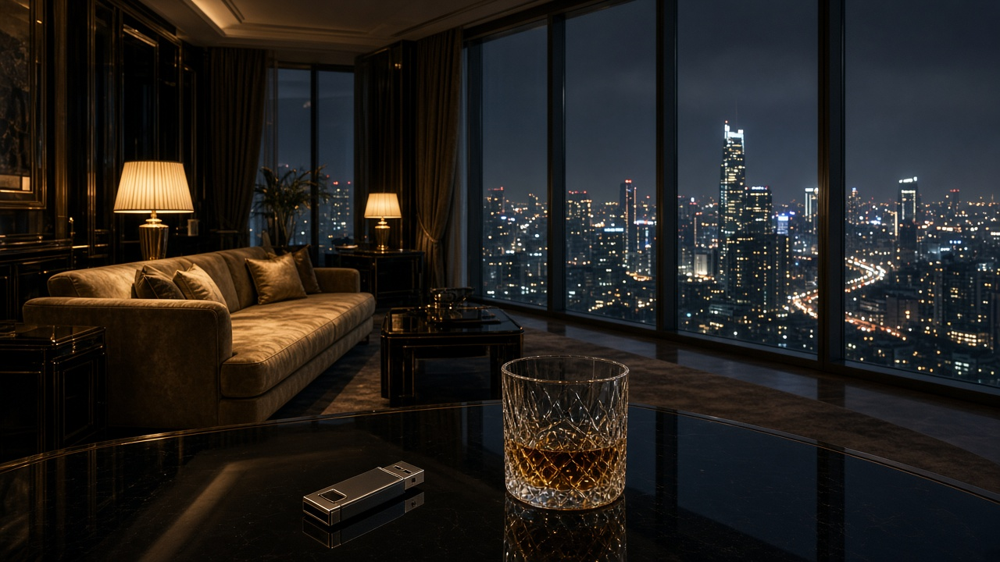
USB + ly / sofa vàng / kính thành phố thật.

### 30. Bếp trung tâm — đêm
Tập 48–49. Khang vs Sẹo.

Chảo treo / cửa pass / băng chuyền.

### 31. Sân thượng khách sạn — đêm
Tập 53–55. “Mày sẽ sống. Để ra toà.”

Lan can mờ / sàn ướt / thành phố rơi. Cùng logic Skyline.

### 32. Cổng sau khách sạn — đêm
Tập 61. Còng. Flash phố.
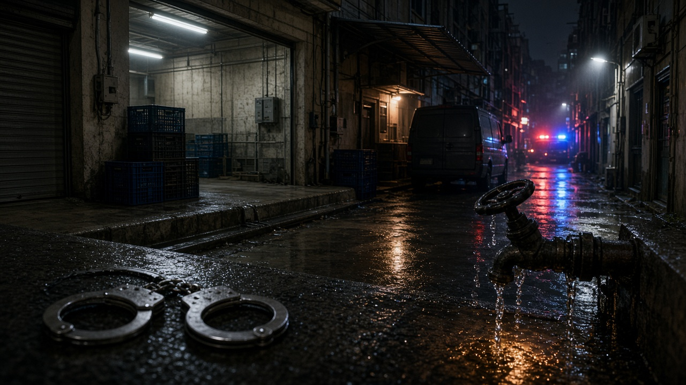
Còng + van / dock / đèn cảnh sát.

### 33. Nghĩa trang — sáng
Tập 57. Mai treo chìa rồi lấy lại.

Một nấm không hoa / đá xa / cây sương.

---

## Quay tuần — gộp theo ánh sáng

| Đêm / ngày | Gộp | Plate |
|---|---|---|
| Một đêm Skyline | hầm + thang + sân thượng + sảnh | 1–4 |
| Một ngày căn hộ | 1508 + rác + 1015 | 5, 6, 11 |
| Một ngày hẻm | phở ngoài/trong + văn phòng + toà soạn + café | 7–10, 12 |
| Một bình minh sông | phà + xóm chài + đước | 13–15 |
| Một ngày kính | An Sinh + tầng 18 + lab + khoa nhi | 17–20 |
| Một đêm hệ thống | kho flash + công an + Tao Đàn + mini | 16, 21–23 |
| Một chiều ga | tủ + hẻm đuổi | 24–25 |
| Một đêm Đế Vương | thảm đỏ + ballroom + booth + VIP + bếp + sân + cổng | 26–32 |
| Một sáng im | nghĩa trang + văn phòng mới | 33, 9 |

Tín’s phone đã là 9:16. Footage đó không cần relight — chỉ cần hạt và hơi của set đang đứng.

---

## Ghi chú

- Chữ trên hình là đồ thật (biển phở, số tủ, timestamp). Không title đè plate.
- Căn 1508 được phép phẳng: đã bị lục, hết bóng người.
- Hai sân thượng phải đọc được là một độ cao, một thành phố.
- Hẻm đuổi phải giữ đường tụ khi crop 9:16.
