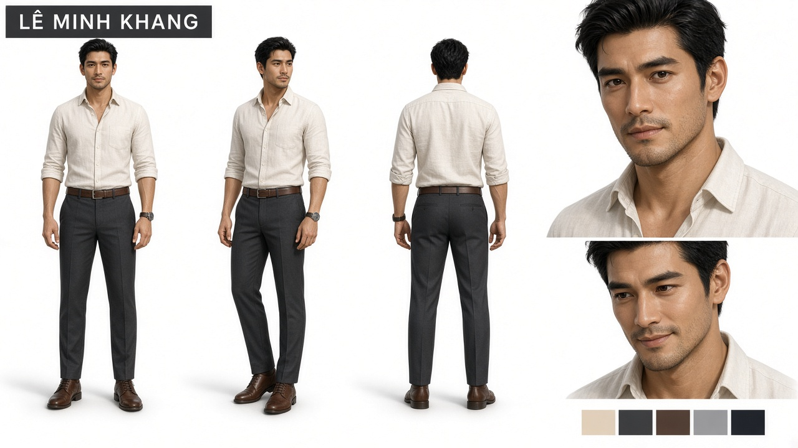
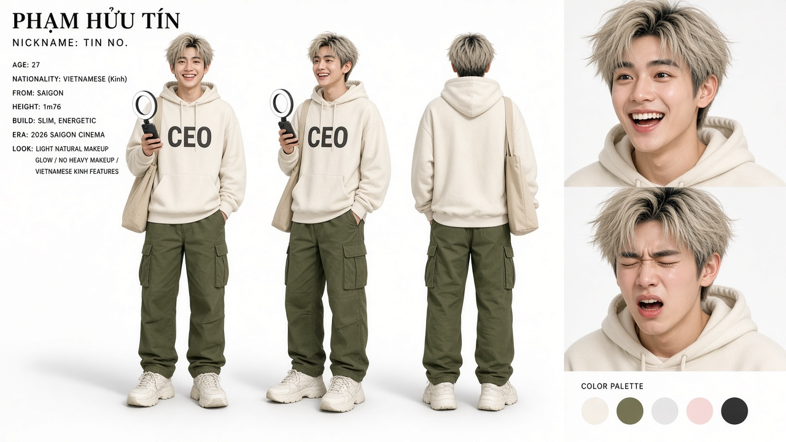
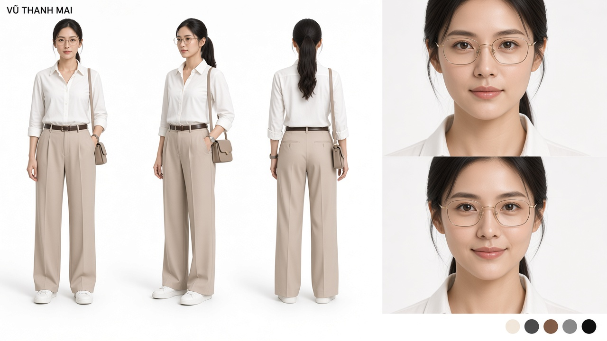
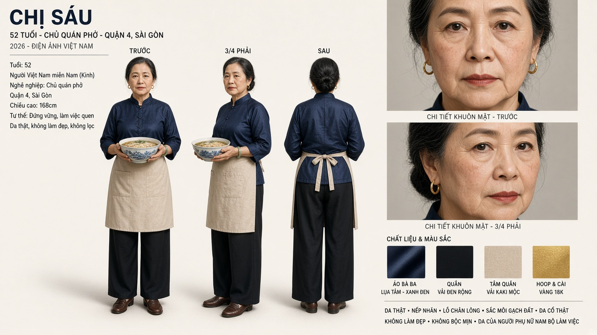
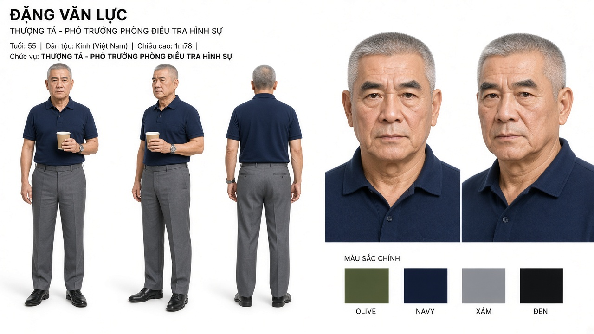
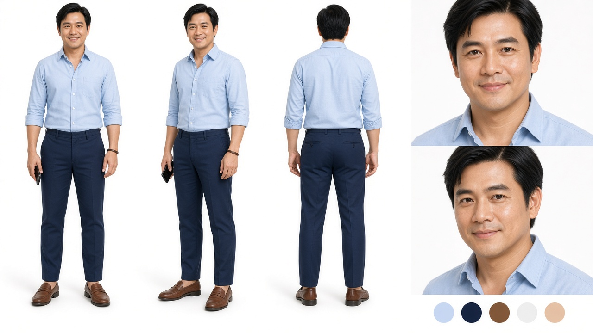
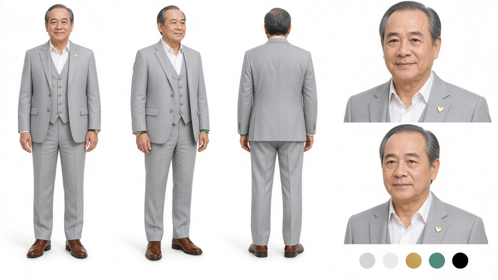
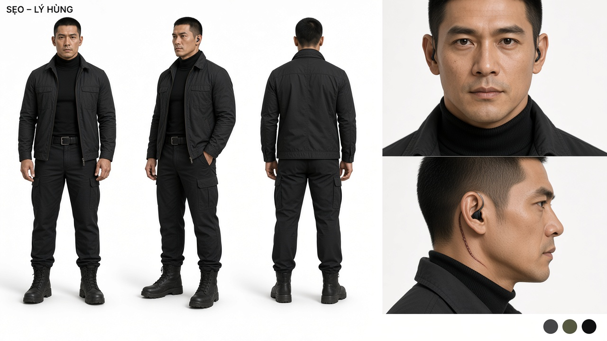

# CHARACTER SHEET – HỒ SƠ 1015

Thiết kế tạo hình nhân vật. Bối cảnh Sài Gòn 2026, phong cách hiện đại, tân tiến. Nguyên tắc chung cho toàn bộ dàn diễn viên:

- **Dân tộc / khuôn mặt:** toàn bộ là người Việt Kinh, Sài Gòn 2026. Mặt oval thon, xương gò má cao, mũi thẳng thanh, mắt một mí hoặc hai mí nhẹ kiểu Á Đông Việt, lông mày tự nhiên không dày kịch. Nam cạo sạch, không ria mép dày, không râu quai nón đậm. **Không** dùng gương mặt Thái / lakorn (da nâu sẫm, lông mày đậm, sống mũi cao kiểu lai).
- **Ngoại hình:** đẹp, cao, vóc dáng cân đối. Nam từ 1m76 trở lên, nữ từ 1m68 trở lên.
- **Da:** sáng hồng kiểu da Việt Nam thành thị – ivory ấm đến be hồng, má ửng. **Kết cấu da thật, không airbrush:** lỗ chân lông thấy được ở mũi và má, ánh dầu nhẹ vùng T, lông tơ, sắc tố hơi lệch, vết thời gian đúng tuổi. Ánh sáng xuyên lớp da (subsurface scattering), không da nhựa / glass skin.
- **Trang phục:** hiện đại, tối giản, vừa vặn (slim/tailored), chất liệu tốt (linen, cotton, silk, wool). Mỗi nhân vật có một bảng màu riêng để dễ nhận diện trong khung hình.
- **Nguyên tắc "đẹp nhưng thật":** không nhân vật nào trông như người mẫu quảng cáo; vẻ đẹp phải đi với nghề nghiệp và tính cách.

---

## 1. LÊ MINH KHANG – Thám tử tư

| | |
|---|---|
| **Tuổi / Chiều cao** | 36 / 1m82 |
| **Vóc dáng** | Gầy rắn, vai rộng, kiểu người tập võ chứ không tập gym |
| **Gương mặt** | Góc hàm sắc, mắt sâu luôn như đang "đọc" người đối diện, vết sẹo mờ nhỏ ở cằm |
| **Tóc** | Đen, ngắn, vuốt ngược tự nhiên, hơi rối về cuối ngày |
| **Da / Trang điểm** | Da sáng hồng kiểu Kinh thành thị, không trang điểm – chỉ dưỡng để da khoẻ. Cạo sạch, không ria |
| **Trang phục chủ đạo** | Sơ mi linen màu ngà xắn tay đến khuỷu, quần âu xám than ống đứng, thắt lưng da nâu, boots da nâu, đồng hồ thép tối giản |
| **Biến thể** | Đêm gala: vest đen mượn, hơi rộng vai. Hành động: cùng bộ nhưng rách, ướt, dính bột chữa cháy |
| **Bảng màu** | Ngà – Xám than – Nâu da – Đen |
| **Chi tiết nhận diện** | Gõ hai ngón tay lên bàn khi nghĩ. Tay áo luôn xắn |

## 2. PHẠM HỮU TÍN – "TÍN NỔ" – Trợ lý

| | |
|---|---|
| **Tuổi / Chiều cao** | 27 / 1m76 |
| **Vóc dáng** | Mảnh, nhanh nhẹn, dáng đi hơi nhún nhảy |
| **Gương mặt** | Nét trẻ, mắt to biểu cảm, nụ cười rộng "hớn hở", lông mày tự nhiên |
| **Tóc** | Nhuộm vàng tro đã phai, chân tóc đen, cố tình rối |
| **Da / Trang điểm** | Da trắng hồng, má ửng. Trang điểm nhẹ kiểu Gen Z nam: kem nền mỏng, son dưỡng có màu, kẻ mày |
| **Trang phục chủ đạo** | Hoodie oversize màu kem in chữ "CEO" (tự in), quần cargo ô-liu, sneaker trắng đế dày, túi tote vải có mèo Hồ Sơ thò đầu, điện thoại gắn ring light mini |
| **Biến thể** | Nhân viên dọn nhà hậu tang (áo thun in chữ mới toanh); thầy phong thuỷ (áo dài gấm xanh đậm + quần trắng + giày thể thao quên thay); KOL gala (vest trắng thuê 400 ngàn, kính râm ban đêm) |
| **Bảng màu** | Kem – Ô-liu – Trắng – Hồng phấn (má) |
| **Chi tiết nhận diện** | Ring light. Mèo. Hắt xì |

## 3. VŨ THANH MAI – Dược sĩ

| | |
|---|---|
| **Tuổi / Chiều cao** | 30 / 1m70 |
| **Vóc dáng** | Mảnh, thẳng lưng, dáng người đi bộ nhiều trong bệnh viện |
| **Gương mặt** | Thanh tú, mắt điềm tĩnh, môi mỏng, kính gọng vàng mảnh |
| **Tóc** | Đen dài, buộc đuôi ngựa cao, mượt, không một sợi lệch |
| **Da / Trang điểm** | Da trắng hồng trong, trang điểm nhẹ: cushion mỏng, má hồng đào, son hồng đất, mày tự nhiên. Không mascara đậm |
| **Trang phục chủ đạo** | Sơ mi trắng tailored sơ vin, quần ống rộng cạp cao màu be, thắt lưng đen mảnh, sneaker trắng, túi đeo chéo nhỏ dáng hộp, khuyên tai nụ |
| **Biến thể** | Đi Cần Giờ: áo khoác chống nắng rẻ tiền, mũ bảo hiểm cũ ("mặc đồ xấu"). Sau rừng đước: áo thun "CEO" mượn của Tín. Blouse trắng ở Viện Kiểm nghiệm |
| **Bảng màu** | Trắng – Be – Đen – Vàng kim (kính, khuyên) – Hồng đào |
| **Chi tiết nhận diện** | Túi áo khoác luôn có ống thuốc thuỷ tinh – vũ khí ở sân thượng |

## 4. CHỊ SÁU – Chủ quán phở

| | |
|---|---|
| **Tuổi / Chiều cao** | 52 / 1m68 |
| **Vóc dáng** | Thẳng, chắc, dáng người bưng phở hai mươi năm |
| **Gương mặt** | Đẹp kiểu phụ nữ Nam Bộ từng trải, mắt sắc, ít biểu cảm, nếp nhăn đuôi mắt đẹp |
| **Tóc** | Đen điểm vài sợi bạc, búi thấp gọn |
| **Da / Trang điểm** | Da hồng khoẻ nhờ đứng bếp, trang điểm rất nhẹ: chút son màu gạch, kẻ mày mảnh |
| **Trang phục chủ đạo** | Áo bà ba cách tân lụa xanh navy có hoa văn chìm, quần đen ống rộng, tạp dề vải be buộc eo, khuyên tai vòng vàng, vòng ngọc bích, giày da lười |
| **Biến thể** | Đêm cháy: áo ngủ, tóc xoã, chân trần – vẫn vác thang. Đêm gala: tạp dề mới, đứng trên thùng xe phở |
| **Bảng màu** | Navy – Đen – Be – Vàng (trang sức) |
| **Chi tiết nhận diện** | Tô phở trên tay. Mặt không đổi dù nói câu gì |

## 5. THƯỢNG TÁ ĐẶNG VĂN LỰC – Phó Trưởng phòng CSHS

| | |
|---|---|
| **Tuổi / Chiều cao** | 55 / 1m78 |
| **Vóc dáng** | Chắc, vai vuông, dáng đứng quân nhân |
| **Gương mặt** | Nghiêm, chân mày đậm, mắt sâu không đọc được, nếp nhăn trán |
| **Tóc** | Bạc trắng, cắt cua sát |
| **Da / Trang điểm** | Da hồng khoẻ, không trang điểm, cạo râu sạch |
| **Trang phục chủ đạo** | Thường phục: polo xanh navy, quần tây xám, giày da đen, đồng hồ thép cũ, ly cà phê đen giấy. Lễ phục: quân phục xanh rêu đầy đủ cấp hiệu (đêm gala) |
| **Bảng màu** | Xanh rêu – Navy – Xám – Đen |
| **Chi tiết nhận diện** | Nói chậm, không thừa chữ. Ly cà phê đen không đường |

## 6. ĐẠI UÝ HOÀNG NAM – Bạn cũ, kẻ phản bội

| | |
|---|---|
| **Tuổi / Chiều cao** | 36 / 1m80 |
| **Vóc dáng** | Thể thao, cân đối – người "đẹp trai nhất đội" |
| **Gương mặt** | Dễ mến, má lúm, nụ cười ấm – nhưng mắt phải diễn được hai trạng thái: ấm và trống rỗng |
| **Tóc** | Đen, dài vừa, rẽ ngôi lệch gọn gàng |
| **Da / Trang điểm** | Da hồng sáng, chăm sóc kỹ, hơi "quá đẹp" so với lương công an – gợi ý ngầm về tiền |
| **Trang phục chủ đạo** | Sơ mi oxford xanh nhạt xắn tay, chinos navy, giày lười da nâu, vòng tay da mảnh, điện thoại luôn trên tay |
| **Bảng màu** | Xanh nhạt – Navy – Nâu – Trắng |
| **Chi tiết nhận diện** | Nụ cười. Vỗ vai Khang |

## 7. TRỊNH QUỐC BẢO – Chủ tịch An Sinh, kẻ chủ mưu

| | |
|---|---|
| **Tuổi / Chiều cao** | 50 / 1m80 |
| **Vóc dáng** | Săn chắc, dáng diễn giả, tay hay mở rộng khi nói |
| **Gương mặt** | Phong độ, lịch lãm, nụ cười hiền "quen được chụp hình" – không bao giờ chạm tới mắt |
| **Tóc** | Muối tiêu, chải chuốt hoàn hảo từng sợi |
| **Da / Trang điểm** | Da hồng mịn, chăm sóc spa định kỳ, có lớp phấn phủ rất mỏng cho máy quay |
| **Trang phục chủ đạo** | Vest ba mảnh xám nhạt may đo, sơ mi trắng mở cổ không cà vạt, ghim cài áo hình trái tim vàng (logo Quỹ), đồng hồ vàng, giày oxford nâu bóng, vòng hạt ngọc bích nhỏ |
| **Biến thể** | Gala: vest xám đậm hơn, có cà vạt. Sân thượng: vest xộc xệch, lần đầu không chỉnh tề |
| **Bảng màu** | Xám bạc – Trắng – Vàng kim – Xanh ngọc |
| **Chi tiết nhận diện** | Ghim trái tim vàng. Vòng ngọc bích (phong thuỷ) |

## 8. SẸO – LÝ HÙNG – Trưởng an ninh, tay chân của Bảo

| | |
|---|---|
| **Tuổi / Chiều cao** | 40 / 1m85 |
| **Vóc dáng** | Cao nhất phim, cơ bắp đặc, di chuyển không thừa động tác |
| **Gương mặt** | Góc cạnh, mắt lạnh và tĩnh, vết sẹo dài mảnh từ sau tai phải chạy xuống cổ |
| **Tóc** | Đen, húi cua |
| **Da / Trang điểm** | Da sáng hồng hơi ngăm khoẻ, sẹo được làm nổi nhẹ bằng hiệu ứng, không trang điểm khác |
| **Trang phục chủ đạo** | Toàn đen "tactical-chic": áo cổ lọ đen ôm, jacket đen slim, quần cargo đen, boots chiến thuật, tai nghe dây xoắn, găng tay da đen giắt thắt lưng |
| **Biến thể** | Phà Bình Khánh: mũ bảo hiểm fullface, áo khoác thường. Bếp khách sạn: cởi jacket, chỉ còn cổ lọ |
| **Bảng màu** | Đen – Than – Nâu da (sẹo, da) |
| **Chi tiết nhận diện** | Vết sẹo. Im lặng. Chọn dao nhỏ, không chọn dao to |

---

## Bảng so sánh nhanh

| Nhân vật | Tuổi | Cao | Màu chủ đạo | Một từ khoá tạo hình |
|---|---|---|---|---|
| Khang | 36 | 1m82 | Ngà / Xám than | Xắn tay áo |
| Tín | 27 | 1m76 | Kem / Ô-liu | Ring light |
| Mai | 30 | 1m70 | Trắng / Be | Đuôi ngựa cao |
| Chị Sáu | 52 | 1m68 | Navy / Be | Tạp dề |
| Lực | 55 | 1m78 | Xanh rêu / Navy | Tóc bạc cua |
| Nam | 36 | 1m80 | Xanh nhạt / Navy | Má lúm |
| Bảo | 50 | 1m80 | Xám bạc / Vàng | Ghim trái tim |
| Sẹo | 40 | 1m85 | Đen | Vết sẹo |

---

## Nhân vật phụ – tạo hình

Cùng layout với Khang: studio trắng, 3 góc + close-up, da thật, nét Kinh. Không cần đẹp như dàn chính – cần **đúng nghề, đúng tuổi**.

### 9. VŨ THANH HÀ – Nhà báo (nạn nhân)

| | |
|---|---|
| **Tuổi / Chiều cao** | 34 / 1m68 |
| **Gương mặt** | Thanh, mắt thức đêm, môi mỏng |
| **Tóc** | Đen, búi thấp lúc làm việc, xoã khi teaser |
| **Trang phục** | Blazer xám nhàu, áo thun trắng, túi đeo chéo, giày bệt |
| **Da** | Sáng hồng mệt, quầng mắt thật, không che |
| **Bảng màu** | Xám – Trắng – Đen |

### 10. ÔNG TƯ ĐỜN – LÊ VĂN TƯ – Cựu thủ kho

| | |
|---|---|
| **Tuổi / Chiều cao** | 62 / 1m70 |
| **Gương mặt** | Gầy, râu bạc lởm chởm, nắng Cần Giờ |
| **Trang phục** | Áo thun sờn, quần short kaki, dép tổ ong |
| **Da** | Hồng ngăm khoẻ, nếp nhăn sâu, không airbrush |
| **Bảng màu** | Be sờn – Nâu – Xám bạc |

### 11. BÀ GIÁO LAN – NGUYỄN THỊ LAN

| | |
|---|---|
| **Tuổi / Chiều cao** | 70 / 1m58 |
| **Gương mặt** | Mắt sáng, tóc bạc búi, nếp nhăn đẹp |
| **Trang phục** | Áo bà ba lụa nhạt, quần đen, dép trong nhà |
| **Da** | Mỏng, đốm tuổi, hồng ở má |
| **Bảng màu** | Kem – Đen – Bạc |

### 12. NGUYỄN HOÀNG DŨNG – Đồng đội (flashback)

| | |
|---|---|
| **Tuổi / Chiều cao** | 30 / 1m78 |
| **Gương mặt** | Trẻ, cười dấu V trên ảnh bàn Khang |
| **Trang phục** | Quân phục cảnh sát / áo giáp đêm Bình Chánh |
| **Da** | Hồng khoẻ, mồ hôi, không son phấn |
| **Bảng màu** | Xanh rêu – Đen |

### 13. TRẦN MỸ LINH – Biên tập viên

| | |
|---|---|
| **Tuổi / Chiều cao** | 33 / 1m68 |
| **Gương mặt** | Kính gọng đen, mắt tránh nhìn |
| **Trang phục** | Cardigan xám, sơ mi, thẻ toà soạn |
| **Da** | Sáng, hơi khô vì đèn tuýp, cushion mỏng |
| **Bảng màu** | Xám – Đen – Trắng |

### 14. LÊ THỊ HƯƠNG – Mẹ bé Minh

| | |
|---|---|
| **Tuổi / Chiều cao** | 34 / 1m62 |
| **Gương mặt** | Mệt, mắt thâm, đẹp vì thật |
| **Trang phục** | Áo thun nhàu, quần jean, dép |
| **Da** | Hồng mệt, không trang điểm |
| **Bảng màu** | Xanh nhạt – Be |

### 15. PHẠM THỊ HOA – Mẹ Tín

| | |
|---|---|
| **Tuổi / Chiều cao** | 58 / 1m60 |
| **Gương mặt** | Ấm, tóc búi, nếp cười |
| **Trang phục** | Áo bà ba lụa nhạt, mang nồi cơm bọc khăn |
| **Da** | Hồng khoẻ chợ, đốm nắng |
| **Bảng màu** | Kem – Nâu |

### Tầng ba – không cần sheet riêng

Hạnh (tóc ngắn, blouse Viện), Hải (quân phục, mặt khó xử), Hổ (xăm hổ cổ tay), Việt (mũ lưỡi trai), Ngọc (tóc búi, đồng phục An Sinh), Khoa (áo đen, tai nghe), Quân / My / Phát / Bà Tư Bánh / Sơn / MC Thanh / Hoàng / Long: hoá trang theo nghề, da thật, nét Kinh.

## Ghi chú cho bộ phận hoá trang

- Tham chiếu tạo hình: diễn viên điện ảnh Việt Nam đương đại (Kinh, da sáng hồng), **không** tham chiếu phim Thái / lakorn.
- Toàn bộ nhân vật dùng tông da **sáng hồng tự nhiên** và **kết cấu da thật**: lỗ chân lông, vân da, ánh dầu vùng T, không airbrush, không glass skin.
- Nam giới: cạo sạch (còn bóng lông), kẻ mày nhẹ, son dưỡng. Không ria mép dày. Da phải đọc được tuổi.
- Nữ giới: *no-makeup makeup* – cushion mỏng đến mức vẫn thấy lỗ chân lông, má hồng đào, son tiệp môi. Không foundation che kín da.
- Độ "hoàn hảo" của da tỉ lệ nghịch với độ trung thực của nhân vật: **Bảo và Nam** da hoàn hảo nhất (có tiền, có che giấu); **Khang, Chị Sáu, Lực** da khoẻ nhưng có dấu vết thời gian; **Tín và Mai** trẻ, tươi, hồng tự nhiên.
