# TRANG NHÂN VẬT PHỤ — HỒ SƠ 1015

Mọi vai có tên **ngoài tám chính**. Tám chính (Khang, Tín, Mai, Chị Sáu, Lực, Nam, Bảo, Sẹo) nằm ở `character-sheet.md`. Trang này giữ hết tầng 2, tầng 3, tầng 4, mèo Hồ Sơ.

Mặt phải đọc được từ xa trên điện thoại 9:16. Da thật, nét Kinh, đúng nghề, đúng tuổi — không cần đẹp như dàn chính.

| Tầng | Ai | Sheet |
|---|---|---|
| 2 | Hà, Ông Tư, Bà Lan, Dũng, Linh, Hương + bé Minh, Hoa | 7 sheet riêng |
| 3 | Hạnh, Hải, Hổ, Việt, Ngọc, Khoa | 6 sheet riêng |
| 4 | Quân, My, Phát, Bà Tư Bánh, Sơn, MC Thanh, Hoàng, Long, KOL, Khách trẻ | 1 tấm nhóm |
| — | Mèo Hồ Sơ, mã 1015 | không phải người |

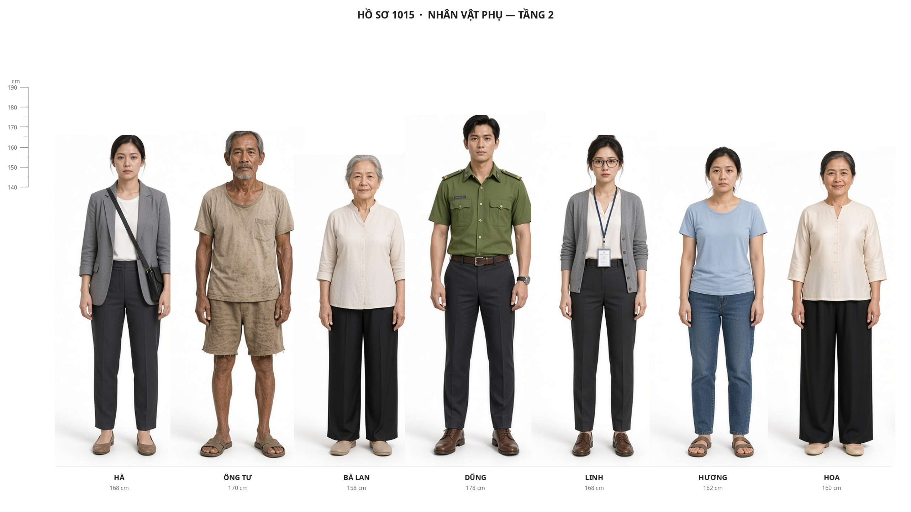

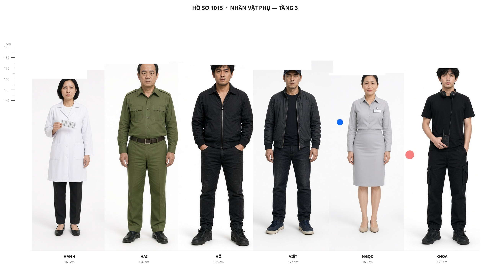

---

## Tầng 2 — Có thoại, có mặt, có sheet

### 9. VŨ THANH HÀ – Nhà báo, nạn nhân · 34 · 1m68

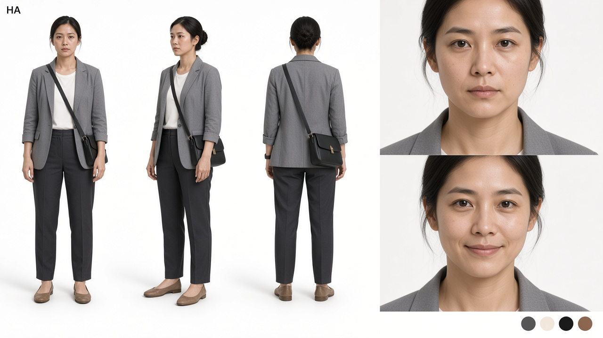

| | |
|---|---|
| **Vai** | Teaser, voicemail, thư. Điều khiển phim từ bên kia. |
| **Gương mặt** | Thanh, mắt thức đêm, môi mỏng |
| **Tóc** | Đen, búi thấp lúc làm việc |
| **Trang phục** | Blazer xám nhàu, áo thun trắng, túi đeo chéo, giày bệt |
| **Da** | Sáng hồng mệt, quầng mắt thật, không che |
| **Bảng màu** | Xám – Trắng – Đen |

### 10. LÊ VĂN TƯ – Ông Tư Đờn – Cựu thủ kho · 62 · 1m70

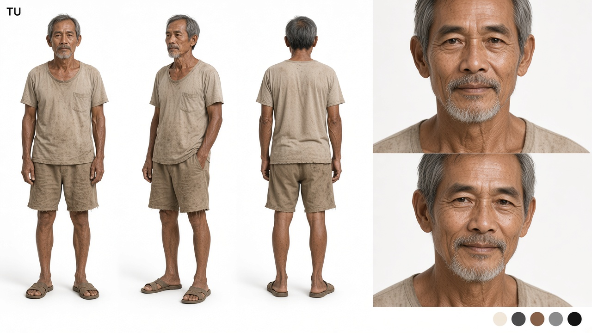

| | |
|---|---|
| **Vai** | Đờn kìm, sổ thật, chết rừng đước. |
| **Gương mặt** | Gầy, râu bạc lởm chởm, nắng Cần Giờ |
| **Trang phục** | Áo thun sờn, quần short kaki, dép tổ ong |
| **Da** | Hồng ngăm khoẻ, nếp nhăn sâu, không airbrush |
| **Bảng màu** | Be sờn – Nâu – Xám bạc |

### 11. NGUYỄN THỊ LAN – Bà Giáo Lan · 70 · 1m58

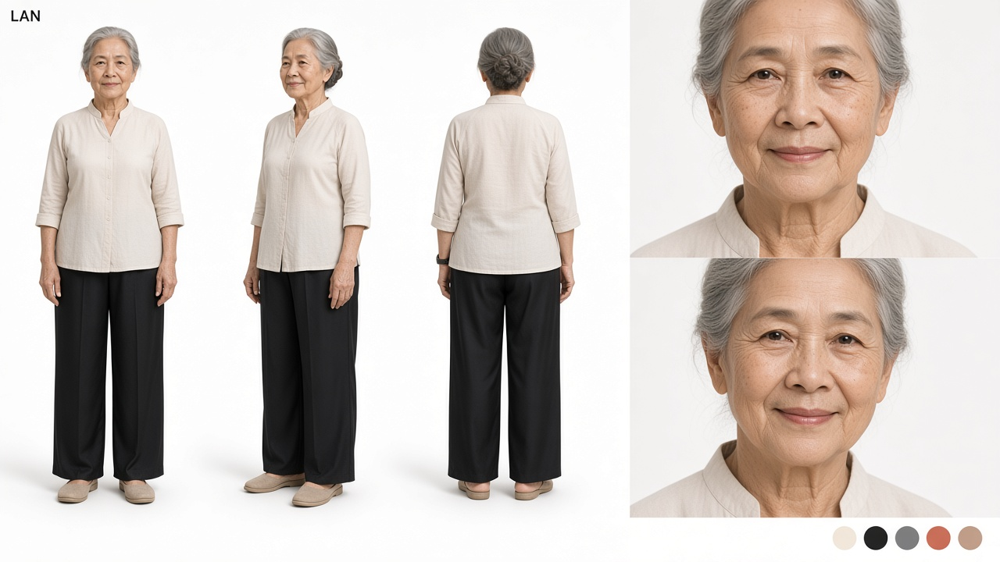

| | |
|---|---|
| **Vai** | Dì Tư, căn 1015. Ca dao. Lớp nghĩa đầu của 1015. |
| **Gương mặt** | Mắt sáng, tóc bạc búi, nếp nhăn đẹp |
| **Trang phục** | Áo bà ba lụa nhạt, quần đen, dép trong nhà |
| **Da** | Mỏng, đốm tuổi, hồng ở má |
| **Bảng màu** | Kem – Đen – Bạc |

### 12. NGUYỄN HOÀNG DŨNG – Đồng đội · 30 · 1m78

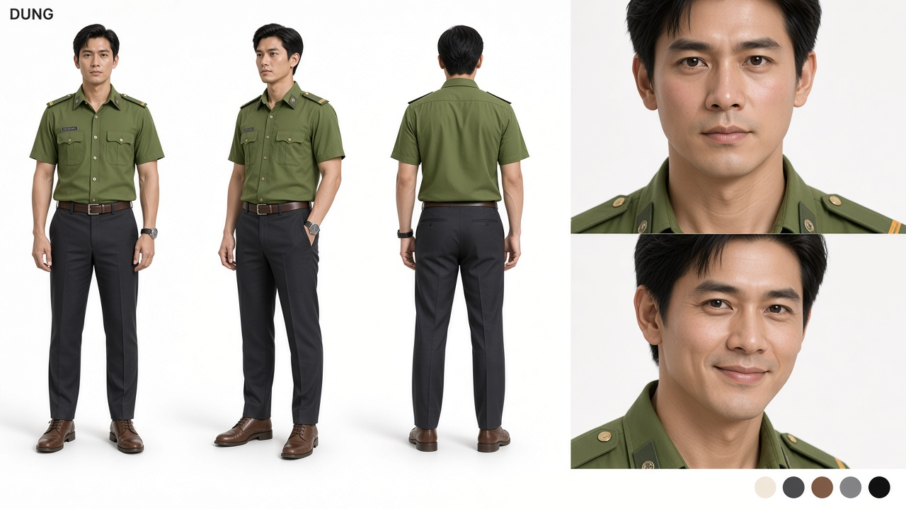

| | |
|---|---|
| **Vai** | Flashback. “Tụi nó biết trước.” Ảnh 4x6 không hoa. |
| **Gương mặt** | Trẻ, cười dấu V trên ảnh bàn Khang |
| **Trang phục** | Quân phục cảnh sát / áo giáp đêm Bình Chánh |
| **Da** | Hồng khoẻ, mồ hôi, không son phấn |
| **Bảng màu** | Xanh rêu – Đen |

### 13. TRẦN MỸ LINH – Biên tập viên · 33 · 1m68

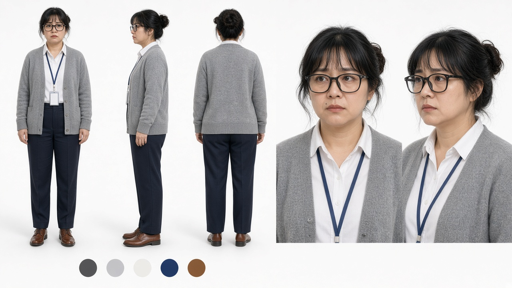

| | |
|---|---|
| **Vai** | Gỡ bài, đưa nháp: đọc trước đám đông. |
| **Gương mặt** | Kính gọng đen, mắt tránh nhìn |
| **Trang phục** | Cardigan xám, sơ mi, thẻ toà soạn |
| **Da** | Sáng, hơi khô vì đèn tuýp, cushion mỏng |
| **Bảng màu** | Xám – Đen – Trắng |

### 14. LÊ THỊ HƯƠNG + BÉ MINH – Khoa nhi · 34 / 4 · 1m62

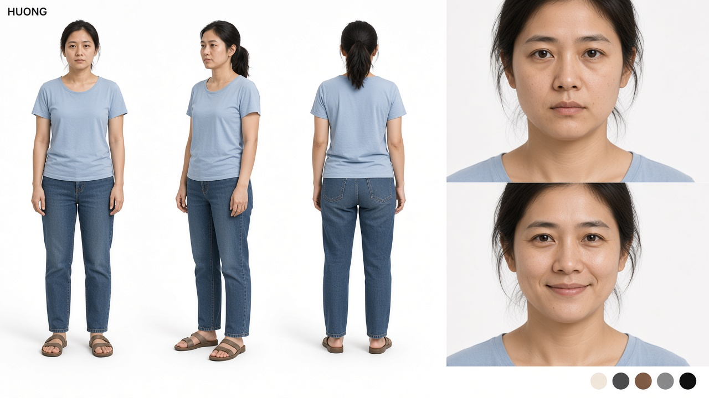

| | |
|---|---|
| **Vai** | Một trong 23 đứa uống đúng lô. Hương hỏi sao thuốc “không chịu”. |
| **Gương mặt** | Mệt, mắt thâm, đẹp vì thật. Bé Minh không cần sheet riêng — chỉ cần mặt mẹ. |
| **Trang phục** | Áo thun nhàu, quần jean, dép |
| **Da** | Hồng mệt, không trang điểm |
| **Bảng màu** | Xanh nhạt – Be |

### 15. PHẠM THỊ HOA – Mẹ Tín · 58 · 1m60

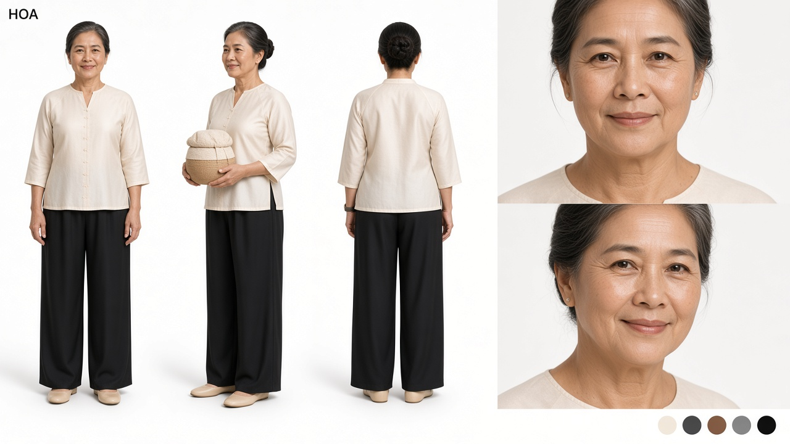

| | |
|---|---|
| **Vai** | Mang cơm. Không hỏi Campuchia. |
| **Gương mặt** | Ấm, tóc búi, nếp cười |
| **Trang phục** | Áo bà ba lụa nhạt, mang nồi cơm bọc khăn |
| **Da** | Hồng khoẻ chợ, đốm nắng |
| **Bảng màu** | Kem – Nâu |

---

## Tầng 3 — Có thoại, có sheet

Trước đây ghi “chưa sheet”. Giờ đủ mặt trên trang phụ.

### 16. NGÔ THỊ HẠNH – Viện Kiểm nghiệm · 32 · 1m68

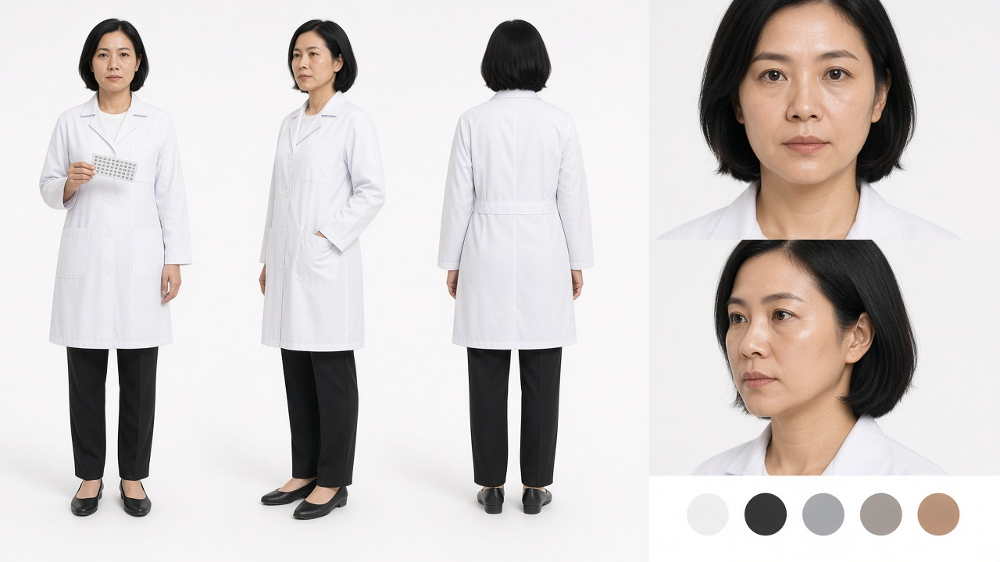

| | |
|---|---|
| **Vai** | Ký 8,3%. Bạn học Mai. Người “đúng quy trình”. |
| **Gương mặt** | Tóc bob ngắn, môi mỏng, mắt nói thẳng |
| **Trang phục** | Áo blouse trắng, quần đen, giày bệt, cầm vỉ thuốc |
| **Da** | Sáng, hơi khô phòng lab, không che quầng |
| **Bảng màu** | Trắng – Đen – Xám |

### 17. TRUNG TÁ PHẠM VĂN HẢI – Đồng nghiệp cũ · 44 · 1m76

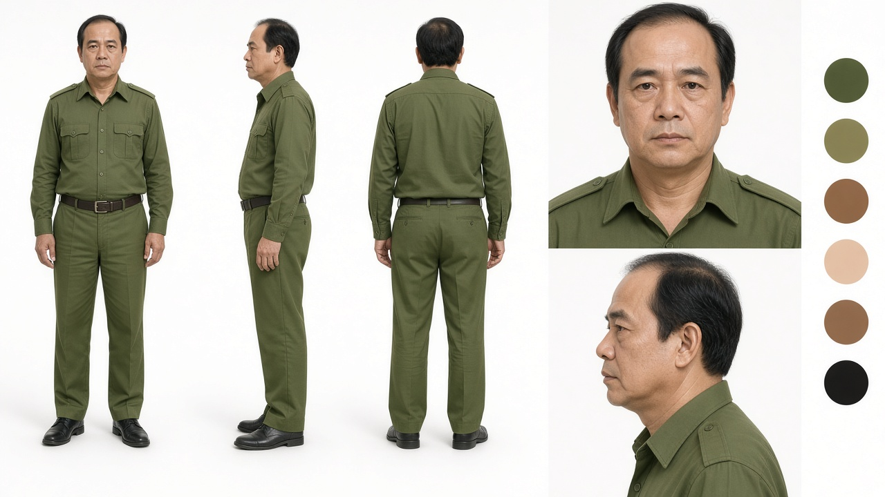

| | |
|---|---|
| **Vai** | Dẫn lệnh triệu tập sau cháy. Hệ thống. Không ác, phải làm. |
| **Gương mặt** | Trán cao, tóc mỏng, miệng khó xử — không phải Lực (cua bạc) |
| **Trang phục** | Sơ mi quân phục rêu, quần âu, giày đen |
| **Da** | Hồng khoẻ, nếp mệt công vụ |
| **Bảng màu** | Rêu – Đen – Nâu |

### 18. ĐỖ VĂN HỔ – Tay chân Sẹo · 28 · 1m75

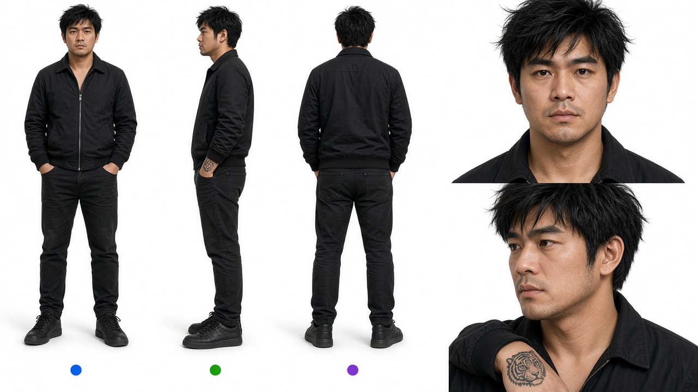

| | |
|---|---|
| **Vai** | Cầu thang, sân thượng. Bị bà Tư Bánh quật dao phết bơ. |
| **Gương mặt** | Trẻ hơn Sẹo, tóc rối, không sẹo cổ |
| **Trang phục** | Áo bomber đen, jean đen, giày thể thao |
| **Chi tiết** | Hình xăm đầu hổ cổ tay trái — phải thấy trong khung |
| **Da** | Hồng ngăm nhẹ, lỗ chân lông, bóng cạo |
| **Bảng màu** | Đen – Xám |

### 19. LÊ QUỐC VIỆT – Tay chân Sẹo · 32 · 1m77

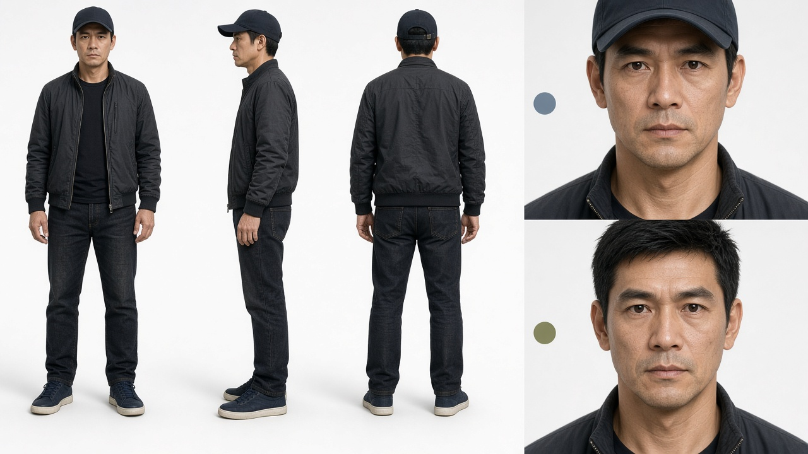

| | |
|---|---|
| **Vai** | Hầm xe, phà, sân thượng. Biết lúc nào biến. |
| **Gương mặt** | Hẹp hơn Hổ, mắt thận trọng |
| **Trang phục** | Áo khoác đen, jean, mũ lưỡi trai / fullface khi hành động |
| **Da** | Sáng hồng thành thị, không xăm hổ |
| **Bảng màu** | Đen – Navy mũ |

### 20. NGUYỄN THỊ NGỌC – Thư ký An Sinh · 35 · 1m65

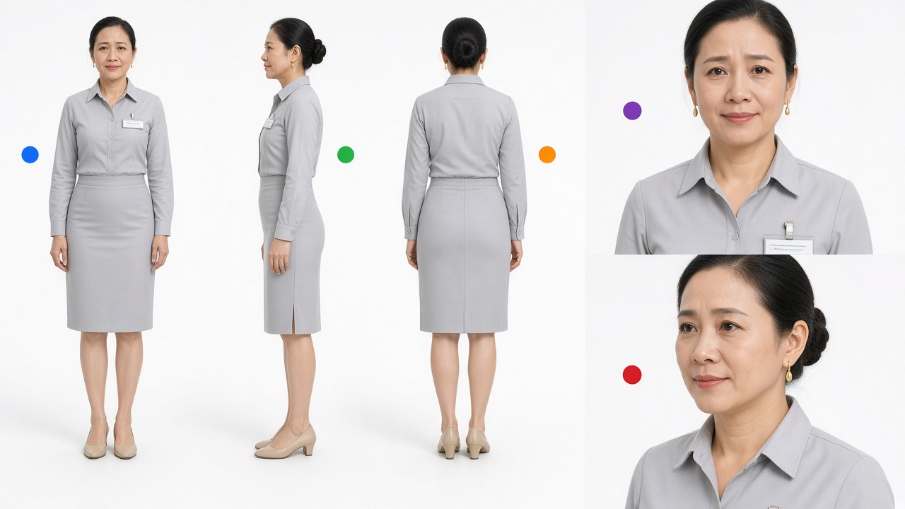

| | |
|---|---|
| **Vai** | Cá rồng chết → tin thầy. Mở cửa để Tín gặp Bảo. |
| **Gương mặt** | Tóc búi, khuyên vàng nhỏ, miệng lo |
| **Trang phục** | Sơ mi xám, chân váy, giày thấp, thẻ tên |
| **Da** | Sáng, cushion mỏng, vẫn thấy lỗ chân lông |
| **Bảng màu** | Xám nhạt – Be |

### 21. TRẦN KHOA – Kỹ thuật booth Đế Vương · 25 · 1m72

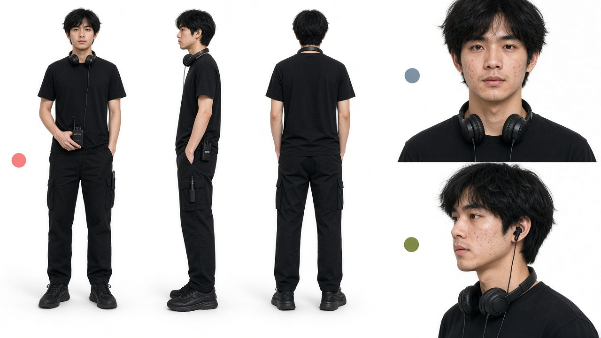

| | |
|---|---|
| **Vai** | Bấm SURPRISE. Mid-credits nhầm “anh Vũ”. |
| **Gương mặt** | Trẻ, gầy, mụn nhẹ, tai nghe |
| **Trang phục** | Áo thun đen, quần cargo, giày thể thao, pack không dây |
| **Da** | Sáng hồng tuổi 25, không airbrush |
| **Bảng màu** | Đen |

---

## Tầng 4 — Một cảnh, một nét

Tám vai có mặt trên tấm nhóm. KOL và Khách trẻ hoá trang theo nghề, không cần sheet riêng.

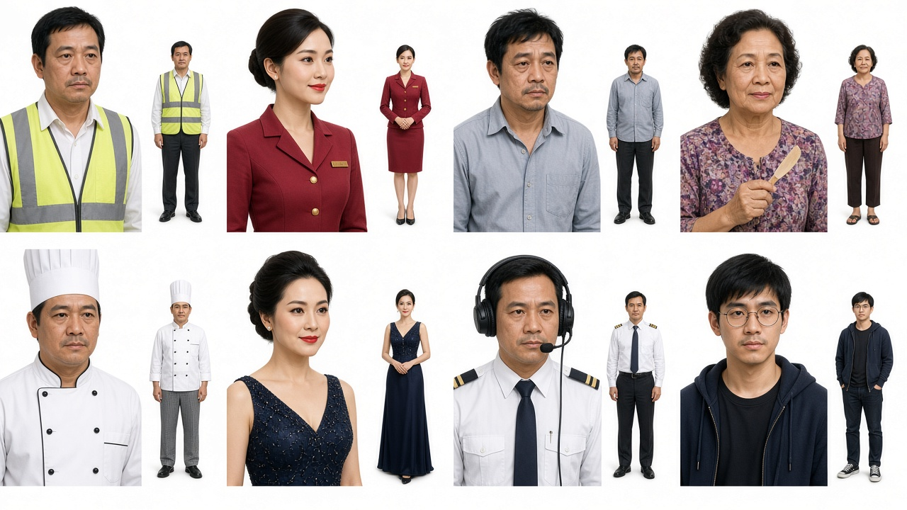

Đọc tấm theo hàng:

| Ô | Tên | Tuổi | Cảnh | Nét |
|---|---|---|---|---|
| 1 | Quân | 40 | Sảnh Skyline | Bảo vệ vest. Tin áo thun chữ to. |
| 2 | Cô My | 24 | Lễ tân An Sinh | “Khí nặng.” Gọi Tín lên. |
| 3 | Anh Phát | 45 | Ga Sài Gòn | Ngáp. Tủ 1015. “Tên con búp bê.” |
| 4 | Bà Tư Bánh | 60 | Hẻm Quận 4 | Dao phết bơ. Quật Hổ. |
| 5 | Sơn | 48 | Bếp Đế Vương | Bỏ đi khi Sẹo hất súp. |
| 6 | MC Thanh | 38 | Gala | Cười gượng khi mất mic. |
| 7 | Phi công Hoàng | 41 | Sân thượng | Tắt máy. Không bay cho người sắp vào tù. |
| 8 | Gã IT Long | 26 | Phòng VIP | Cắm USB giả. Máy “meo meo”. |
| — | Review đồ ăn / hot girl mỹ phẩm | — | Bàn KOL | Một câu. Tín đứng dậy. |
| — | Khách trẻ | 22 | Cảnh 63 | Hỏi phở Thám tử Tín. |

---

## Không phải người, vẫn là vai

**Mèo Hồ Sơ** — mướp của Hà. Dị ứng Tín, chỉ thích Tín. Chị Sáu cứu khỏi lửa. Cảnh cuối ngủ trên hồ sơ.

**1015** — ba lớp: căn hộ / 10:15 camera / tủ Ga Sài Gòn.

---

## Ghi chú hoá trang

- Tham chiếu da thật điện ảnh Việt. Không glass skin. Không lakorn Thái.
- Tầng 2–3: sheet này là khóa mặt. Tầng 4: khóa bằng nghề + một đạo cụ (vest, dao phết bơ, headset, USB).
- Hổ ≠ Sẹo: trẻ hơn, không sẹo cổ, xăm hổ cổ tay.
- Việt ≠ Hổ: mũ, mặt hẹp, không xăm.
- Hải ≠ Lực: tóc còn, trán cao, không cua bạc.
- Hạnh ≠ Mai: bob ngắn, blouse Viện, không kính vàng.
- Ngọc ≠ Linh: búi tóc, đồng phục An Sinh, không kính gọng đen.
