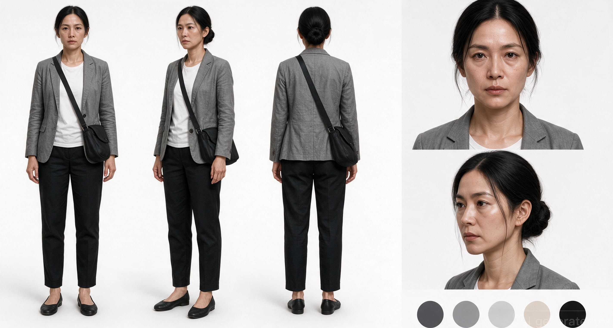
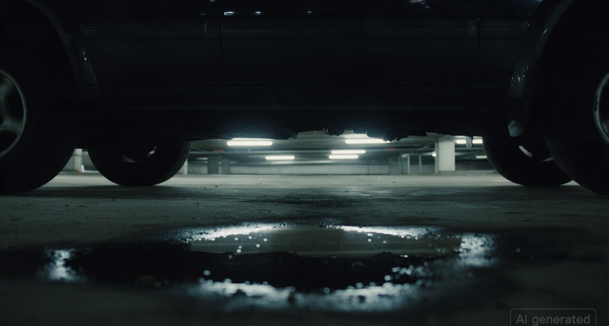
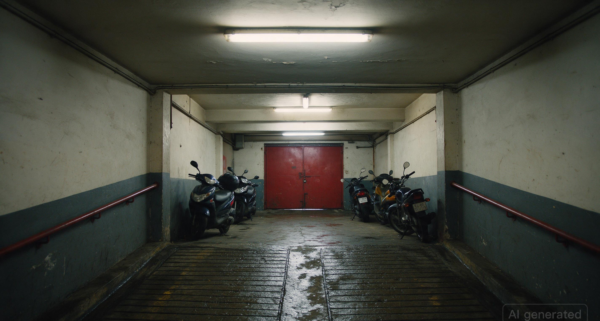
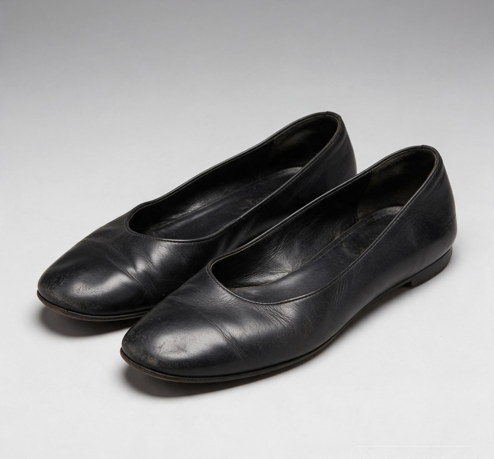
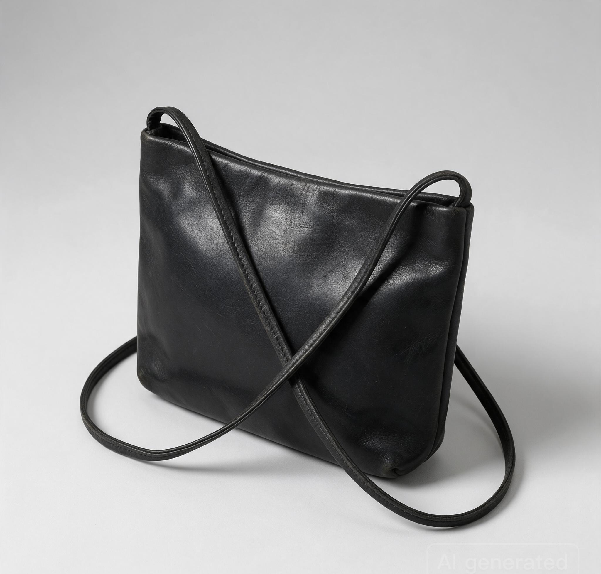

# TẬP 01 — SỐ TRÊN LÒNG BÀN TAY
# Character sheet · Bối cảnh · Đạo cụ
# Seedream 5.0 Pro · Coco

Một file. Một tập. **Chỉ ba loại ảnh.** Không still phân cảnh.

| | |
|---|---|
| **Đồng hồ** | 4s móc / 18s ngoặt / 8s treo · **30 giây** |
| **Set** | Hầm xe Skyline · đêm |
| **Mặt** | Hà hiện hình. Mai chỉ voice. Hai người dưới gầm = giày. |
| **Máy** | Seedream 5.0 Pro · 2K |

Tập này là **một người chị biết mình có thể không về**, để lại bốn số cho em, rồi chạy.

---

## 1. Character sheet

**HÀ — Vũ Thanh Hà · 34 · 1m68**

Dài hẹp, gò má cao, cằm nhọn, mắt sâu mí sụp, quầng thật. Tóc đen búi thấp, ngôi giữa. Blazer xám nhàu, áo thun trắng, quần đen, túi đeo chéo, giày bệt đen. ≠ Linh ≠ Hương.

Mai không lên hình. Không sheet hai người dưới gầm.

---

## 2. Bối cảnh

**NỘI. HẦM XE SKYLINE – ĐÊM**

Hầm lạnh với chị. Ấm chỉ đến từ máy Mai. Huỳnh quang xanh-trắng. Ba lớp: gần / giữa / xa. Cấm neon, cấm sân thượng.

| Plate | Dùng cho |
|---|---|
| Làn xe | Chạy, ngoái, chuông |
| Gầm xe | Một đôi → hai đôi |
| Dốc + cửa đỏ | Hà nắm số, lao ra |

---

## 3. Đạo cụ

| Mã | Vật | Việc trong tập |
|---|---|---|
| Máy nứt | Điện thoại kính vỡ, sáng ấm | Gót → gọi Mai → áp tai |
| Giày bệt | Đen, mòn, không gót | Móc; chạy |
| Túi đeo chéo | Đen, đơn | Khóa trang phục Hà |
| Bút bi | Đen, rẻ | Viết 1 0 1 5 lên da |
| Oxford | Đen, nam, một đôi | Dừng. Đôi hai = kết |

Số **1 0 1 5** viết trên da — không phải đạo cụ giấy.

---

## 4. Phân cảnh — 30 giây · chữ, không ảnh shot

Bản 3. 7 shot. Rút im, không rút câu. Chi tiết: [`phan-canh-tap-01.md`](phan-canh-tap-01.md).

| PC | Giây | Việc | Cảm tắt tiếng |
|---|---|---|---|
| 01 | 0:00–0:04 | Gót → chạy, ngoái, Mai | Đã sợ + nhớ em nửa nhịp |
| 02 | 0:04–0:08 | Chạm tên Mai | Thương, nuốt |
| 03 | 0:08–0:16 | Thì thầm | Xin lỗi / thương |
| 04 | 0:16–0:21 | Viết 1 0 1 5 | Gửi em trên da |
| 05 | 0:21–0:26 | Một đôi → hai đôi | Bị nghe → hết đường |
| 06 | 0:26–0:29 | Chạy, nắm tay | Giữ số = giữ em |
| 07 | 0:29–0:30 | Card | 1015 là chỗ hai chị em |

**V1 0:03 Mai:** *Mai đây, để lại lời nhắn nha.*  
**V2 0:08–0:15 Hà:** *Mai… nếu chị không về. Một không một năm. Chỗ của hai chị em. Chị thương em.*

**Card:** `1015 · CHỖ CỦA HAI CHỊ EM` · `TẬP SAU`

---

## 5. Luật

1. Một set. Không sân thượng.  
2. Hai câu. Mai sáng. Hà vỡ ở cuối.  
3. 1015 = bốn số trên da.  
4. Hà ≠ Linh ≠ Hương.  
5. Giày chưa là Sẹo.  
6. File này không chứa still phân cảnh.  
7. Phân cảnh **30 giây**. Đủ 30.00.
