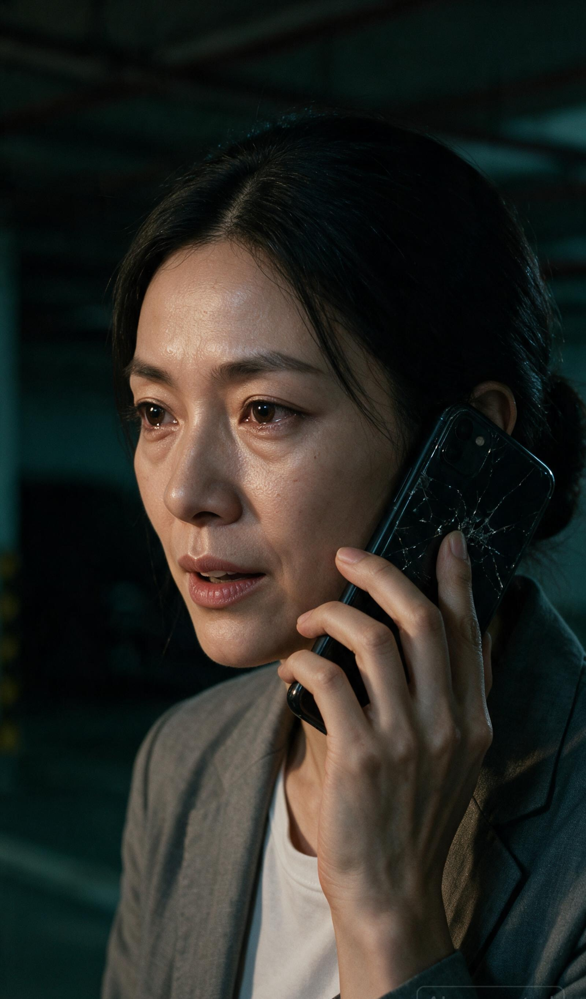
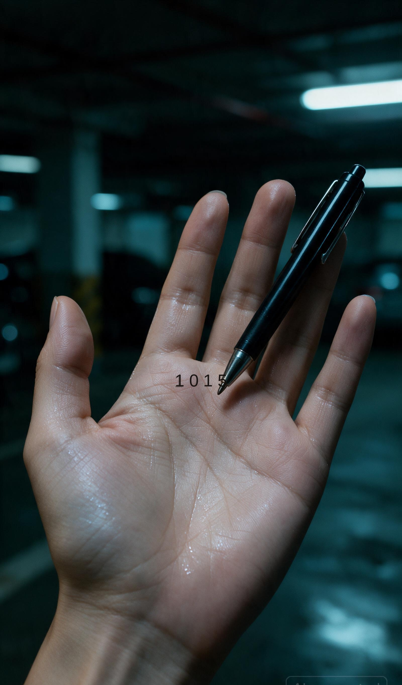
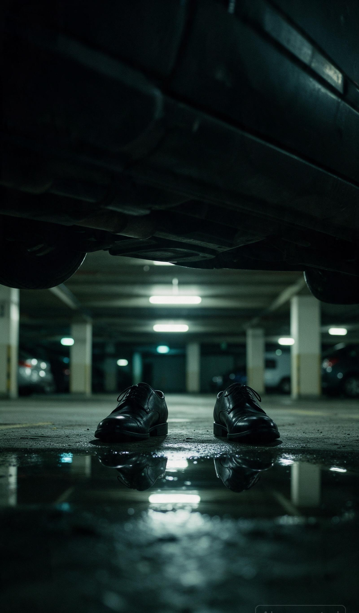
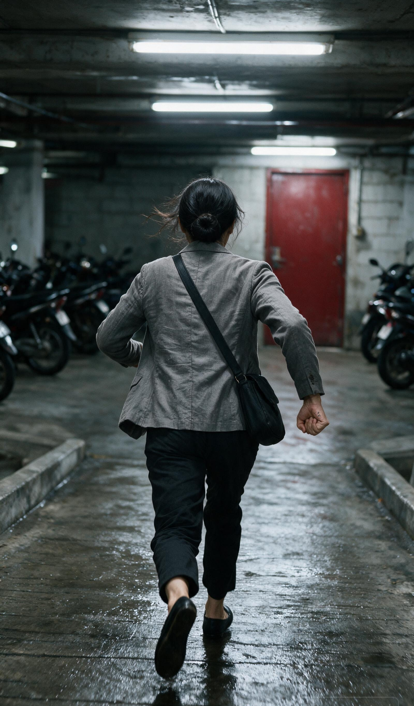
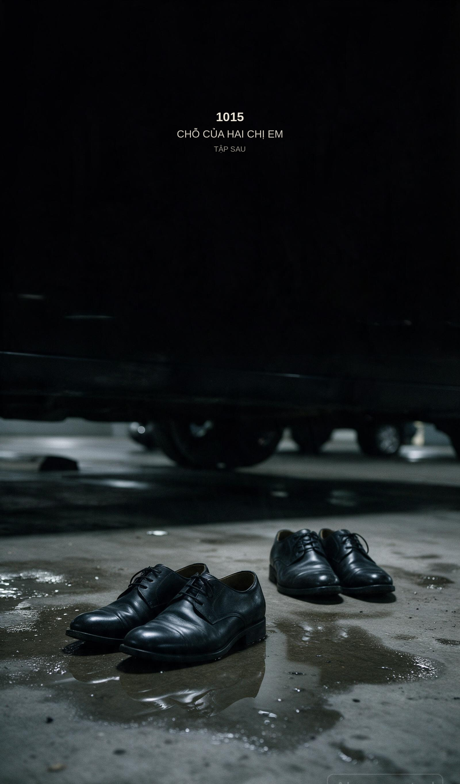

# TẬP 01 — SỐ TRÊN LÒNG BÀN TAY
# Phân cảnh + ảnh · Seedream 5.0 Pro (Coco) · 9:16

Một file. Một tập. Chín phân cảnh. Chín still.

| | |
|---|---|
| **Đồng hồ** | 8s móc / 40s ngoặt / 12s treo |
| **Cung cảm** | Sợ → nhớ em → thương → nắm số → bị nhìn thấy |
| **Set** | Hầm xe Skyline · Quận 7 · đêm |
| **Máy** | Seedream 5.0 Pro · 2K · 9:16 · JPEG |
| **Khoá mặt** | Vũ Thanh Hà · dài hẹp · búi thấp · blazer xám · giày bệt đen |
| **Thoại** | 2 câu. Mai sáng. Hà vỡ ở cuối. |

Tập này không kể âm mưu. Tập này là **một người chị biết mình có thể không về**, để lại bốn số cho em, rồi chạy.

---

## 0. Cung cảm

Hà không diễn “nhà báo bị đuổi”. Hà diễn **chị**.

Mai trên hộp thư đang sống một ngày thường. Giọng sáng. Đó là nhát dao. Hà nghe em còn vô sự — rồi phải nói như người sắp biến mất.

1015 không phải mật mã lạnh. Là chỗ hai đứa từng hẹn. Viết lên da vì giấy sẽ bị lấy. Nắm tay lại vì đó là em.

Hai đôi giày không phải twist hành động. Là thế giới không cho chị nói hết.

**Cảm cấm:** khóc to, run diễn, nhìn máy như MV. Nước mắt được **một lần** — ướt mi, không chảy. Giọng vỡ ở ba chữ cuối thôi.

---

## 1. Nhân vật

| Mã | Tên | Tập này | Cảm trên 9:16 |
|---|---|---|---|
| **HÀ** | Vũ Thanh Hà · 34 · 1m68 | Hiện hình | Sợ thật. Thương em khi nghe Mai. Cắn răng khi viết số. Nắm tay = ôm em. |
| **MAI** | Vũ Thanh Mai · 30 | **Chỉ voice + chữ trên máy** | Không biết chị đang chết. Vui, vội. |
| **—** | Hai người dưới gầm | Chỉ giày | Không cảm. Máy móc. Chậm. |

**Khoá mặt Hà:** dài hẹp, búi thấp, quầng thật, blazer xám nhàu, túi đeo chéo, giày bệt đen. ≠ Linh ≠ Hương.

Không gọi Sẹo. Không nói “tôi là nhà báo”.

---

## 2. Voice

| Cue | Giây | Ai | Cách đọc | Câu |
|---|---|---|---|---|
| **V1** | 0:06–0:08 | MAI · V.O. hộp thư | Sáng, nhanh, hơi cười. Không biết đây là tin cuối. | Mai đây, để lại lời nhắn nha. |
| **V2** | 0:14–0:24 | HÀ · thì thầm | Thấp. Ngừng sau “không về”. Số chậm từng chữ. “Chị thương em” vỡ, nhỏ hơn mọi chữ trước. | Mai… nếu chị không về. Một không một năm. Chỗ của hai chị em. Chị thương em. |

**Đọc số:** *một không một năm* — không “một nghìn mười lăm”.  
**Bỏ:** *Em nhớ số này. 1015. Em sẽ hiểu.*

---

## 3. Phân cảnh + ảnh

Mỗi khối: **Phân cảnh / Cảm / Voice / Bối cảnh / Nhân vật** rồi still Seedream.

---

### PC-01 · 0:00–0:03 · MÓC

Không mở bằng trần trống. Mở bằng **người đang sợ**.

| | |
|---|---|
| **Phân cảnh** | Cận gót bệt đạp vũng. Máy nứt sáng trong tay, nảy theo bước. Trần chớp trên da tay — đèn là nhịp, không phải chủ thể. |
| **Cảm** | Đã chạy từ trước máy bật. Sợ ở chân, chưa ở mặt. |
| **Voice** | Câm lời. Gót + *tíc* đèn. |
| **Bối cảnh** | Bê tông ướt, phản chiếu đèn. Hàng xe máy hai mép. |
| **Nhân vật** | Chỉ chân + tay Hà. Chưa mặt. |

---

### PC-02 · 0:03–0:08 · MÓC

| | |
|---|---|
| **Phân cảnh** | Trung, từ gối lên mặt. Hà chạy về máy. Ngoái một cái — không thấy ai — vẫn chạy. Máy giơ, chuông. |
| **Cảm** | Ngoái = hy vọng hầm trống. Mặt nói: không trống. Khi Mai vào (0:06) mắt **mềm nửa nhịp** — nhớ em — rồi cứng lại. |
| **Voice** | **V1 0:06** — *Mai đây, để lại lời nhắn nha.* Em ở chỗ có đèn, chị ở hầm. |
| **Bối cảnh** | Làn xe = họng. Đèn lạnh. Key ấm duy nhất = kính máy. |
| **Nhân vật** | **HÀ** đầy người. Mặt dài, búi thấp, quầng. Mai không mặt. |

---

### PC-03 · 0:08–0:14 · NGOẶT

| | |
|---|---|
| **Phân cảnh** | Cận kính nứt. Tên *Mai*. Ngón cái run, chạm. Đưa máy lên tai. |
| **Cảm** | Chạm tên em như chạm người. Run vì thương, không vì lạnh. |
| **Voice** | Câm lời. Bíp hộp thư. Chuông chết. |
| **Bối cảnh** | Hầm bokeh. Cả thế giới tối. Mai = một ô sáng vỡ. |
| **Nhân vật** | Tay Hà. Móng ngắn, da mệt. Mai = chữ. |

---

### PC-04 · 0:14–0:28 · NGOẶT

Shot cảm của tập. 14 giây. Không nhét thêm thông tin.

| | |
|---|---|
| **Phân cảnh** | Cận mặt. Máy áp tai, dọc hàm. Mắt lệch máy — nhìn chỗ em không có. Nuốt. Nói. Mi ướt, không chảy. |
| **Cảm** | Không “truyền mật mã”. **Xin lỗi vì sắp biến.** “Chị thương em” = lần duy nhất chị cho phép yếu. |
| **Voice** | **V2 0:14–0:24** — *Mai… nếu chị không về. Một không một năm. Chỗ của hai chị em. Chị thương em.* 0:24–0:28: im. Hơi. |
| **Bối cảnh** | Key ấm trên gò (như đèn nhà Mai). Nền xanh-đen. Không thành phố. |
| **Nhân vật** | **HÀ** đầy khung. Quầng không che. Cấm kính / mái / đuôi ngựa. Cấm diễn “nữ anh hùng”. |

**Phụ đề:** 0:14 *Nếu chị không về.* · 0:18 *Một không một năm.* · 0:21 *Chỗ của hai chị em.* · 0:24 *Chị thương em.*

---

### PC-05 · 0:28–0:38 · NGOẶT

| | |
|---|---|
| **Phân cảnh** | Cận lòng bàn tay trái. Tắt máy. Bút. Viết **1 0 1 5** — bốn số, nét run. Số 1 đầu tiên sai một tẹo, viết đè. |
| **Cảm** | Giấy sẽ bị lấy. Da còn là của chị. Viết như gửi em một chỗ về. |
| **Voice** | Câm. Bút. Ầm. Bước xa bắt đầu — chị nghe, **không ngẩng**. |
| **Bối cảnh** | Da = gần, ấm. Hầm = xa, lạnh. |
| **Nhân vật** | Tay Hà. Số là thư. |

**Khóa số:** đúng bốn ký tự `1 0 1 5`. Không `10155`.

---

### PC-06 · 0:38–0:48 · NGOẶT → TREO

| | |
|---|---|
| **Phân cảnh** | Gầm xe bảy chỗ. Một đôi oxford. Cách ba mét. Chúng **dừng**. |
| **Cảm** | Chị vừa nói thương em. Thế giới trả lời bằng một đôi giày. Dừng = “tao nghe”. |
| **Voice** | Câm. Bước dừng. Im đột ngột nặng hơn bước. |
| **Bối cảnh** | Gầm tối / vũng / đèn xa. Không bánh xe giả làm chân thứ ba. |
| **Nhân vật** | Không mặt. Không gọi Sẹo. |

---

### PC-07 · 0:48–0:54 · TREO

| | |
|---|---|
| **Phân cảnh** | Cùng góc. Đôi thứ hai vào. Bốn giày. |
| **Cảm** | Một người là đuổi. Hai người là **kết**. Chị không còn thương lượng. |
| **Voice** | Câm. Một bước. Đứng. |
| **Bối cảnh** | Giữ set. Không zoom “cho ghê”. |
| **Nhân vật** | Hai người. Không sẹo, không xăm, không mũ. |

---

### PC-08 · 0:54–0:58 · TREO

| | |
|---|---|
| **Phân cảnh** | Hà từ sau. Lao về cửa đỏ. Tay trái **nắm** — 1015 giấu trong lòng bàn tay, như nắm tay em. |
| **Cảm** | Không chạy thoát thân. Chạy **giữ số**. Vai cứng, không quay lại. |
| **Voice** | Câm. Gót dồn. Hơi rách. |
| **Bối cảnh** | Dốc ướt, cửa đỏ. Ba lớp. Không chữ EXIT. |
| **Nhân vật** | Hà sau lưng. Búi thấp, blazer, túi. |

---

### PC-09 · 0:58–1:00 · CARD

| | |
|---|---|
| **Phân cảnh** | Đóng băng hai đôi giày. Chữ thế giới. Không fade. |
| **Cảm** | Câu hỏi của mùa **và** của chị: ai đã biết chỗ của hai chị em. |
| **Voice** | Câm. Ầm giữ. |
| **Bối cảnh** | Gầm tối thêm một nấc. |
| **Nhân vật** | Hai đôi. Hà đã khỏi khung — số còn trên da, ngoài hình. |

**Chữ:** `1015` · `CHỖ CỦA HAI CHỊ EM` · `TẬP SAU`

---

## 4. Bảng tổng

| PC | Giây | Việc | Cảm khi tắt tiếng | Ảnh |
|---|---|---|---|---|
| 01 | 0:00–0:03 | Gót + máy nứt | Đã sợ | `pc-01-got.jpg` |
| 02 | 0:03–0:08 | Chạy, ngoái, Mai reo | Sợ + nhớ em nửa nhịp | `pc-02-chay.jpg` |
| 03 | 0:08–0:14 | Chạm tên Mai | Thương, nuốt | `pc-03-may.jpg` |
| 04 | 0:14–0:28 | Thì thầm rồi im | Xin lỗi / thương | `pc-04-mat.jpg` |
| 05 | 0:28–0:38 | Viết 1 0 1 5 | Gửi em trên da | `pc-05-1015.jpg` |
| 06 | 0:38–0:48 | Một đôi dừng | Bị nghe | `pc-06-giay.jpg` |
| 07 | 0:48–0:54 | Đôi thứ hai | Hết đường nói | `pc-07-hai-doi.jpg` |
| 08 | 0:54–0:58 | Chạy, nắm tay | Giữ số = giữ em | `pc-08-cua.jpg` |
| 09 | 0:58–1:00 | Card | 1015 là chỗ hai chị em | `pc-09-card.jpg` |

---

## 5. Luật

1. Một set. Không sân thượng.  
2. Hai câu. Mai sáng. Hà vỡ ở cuối.  
3. 1015 = bốn số trên da. Không nói “1015” thành tiếng lần hai.  
4. Hà ≠ Linh ≠ Hương.  
5. Giày chưa là Sẹo.  
6. Tắt tiếng: gót → máy → da → hai đôi → nắm tay.  
7. Cảm nằm ở **ngừng** và **nắm**, không ở nước mắt.  
8. Treo bán **chỗ của hai chị em**, không bán “còn tiếp”.

---

## 6. Ghi chú tạo ảnh

- Model: **Seedream 5.0 Pro** trên Coco (`ep-20260809113858-r6jdk`).  
- 9 still × 9 CC = **81 CC** bản đầu; 4 still làm lại (PC-02 búi / PC-03 kính trống / PC-05 lòng trống / PC-07 hai đôi) = 36 CC.  
- Tham chiếu: khóa mặt Hà đã verify trên Coco + character sheet.  
- PC-03, PC-05, PC-09: chữ `Mai` / `1 0 1 5` / card khóa bằng overlay sau khi máy vẽ — Seedream hay viết `10155` và méo tên.  
- Still nằm ở `kich-ban-doc/tap-01-anh/`. Kịch bản thoại: `tap-01-60s-tieng-viet.md`.
